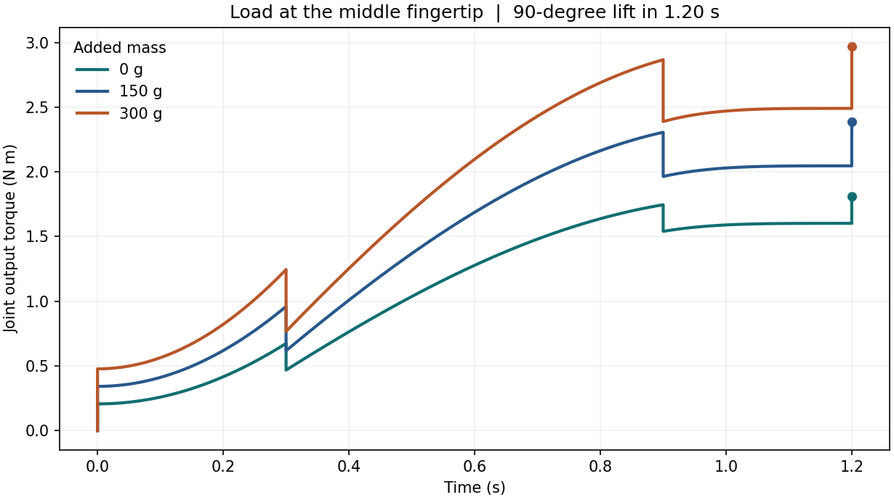

# A lightweight robotic elbow and tendon-driven hand

[中文说明](README.zh-CN.md) · [Hardware permissions](docs/sources-and-rights.md) · [Mechanics and FEA](docs/mechanics.md)

[Integral thumb recess and hanging-release results](docs/fixed-thumb.md) · A fixed concave pad prolonged initial two-finger contact with a 33 g ball. Both 33 g and 150 g spheres fell during the hanging test, before the lift.

[Pickup-position and thumb-angle study](docs/pickup-pose.md) · With the same open-hand closure, moving the pickup and changing thumb opposition delayed final pad separation from 0.070 to 0.168 s in a selected case. The thumb first lost contact at 0.022 s. The ball fell before the horizontal hold.

[Watch the three-cycle SolidWorks arm and hand demonstration (MP4)](assets/arm-hand-motion.mp4) · [Run the elbow lab in Colab](https://colab.research.google.com/github/pyuyan0057-jpg/robot-elbow-portfolio/blob/main/notebooks/elbow_lab.ipynb)

**Free-ball lift result.** When the pickup fixture releases the 150 g equivalent sphere with the arm hanging, the ball rolls and slips. It leaves both pads after **0.108 s at 1.22° of elbow lift** in the CAD-collision simulation. The publicly runnable two-pad model gives 0.104 s. [Watch the solver replay](assets/free-ball-lift.mp4) · [Method and 18 sensitivity cases](docs/free-ball.md) · [Nominal trajectory](examples/free-ball-cad-trajectory.csv)

**Can the joint track a loaded lift, and can the hand retain a ball throughout it?** For a controller that underestimates the fingertip load by 150 g, integral action reduces final hold error from 1.85° to 0.011° in simulation. On the hand, the specified horizontal pinch admits local equilibrium; tilting the elbow introduces a moment that the same two fixed point contacts cannot balance. The whole-arm movie shows prescribed CAD motion. [Controllers, grasp checks and structural trade-offs](docs/controls-and-grasp.md)

A single-axis elbow raises an existing hand and six-drive forearm through 90°. With 150 g at the middle fingertip, it needs **2.390 N·m to hold horizontal**. Widening the fixed motor ring reduced the support's contribution to fingertip sag from **0.2669 to 0.0576 mm** under the archived static load.

<a href="assets/cad-lift.gif"></a> <a href="assets/bracket-comparison.png"></a>

*Left: actual SolidWorks assembly motion. Right: matched bracket views and mount sections. The ring OD grew from 94 to 106 mm and the local spine tie widened. The extra 26.93 g stays on the fixed upper arm. Click either figure to enlarge.*

## Quick start

Use Python 3.11–3.14 with pip in the repository root. The calculator reads local JSON and produces its plot headlessly; the command line requires no CAD software. Tested interpreter and validation commands are listed in [verification](docs/verification.md).

```sh
python -m venv .venv
# Windows PowerShell
.\.venv\Scripts\Activate.ps1
# macOS / Linux: source .venv/bin/activate
python -m pip install -r requirements.txt
python calculate.py --payload-g 150
python calculate.py --payload-g 300
```

Each run writes **torque.png**, **trajectory.csv**, **inputs.json** and **summary.json** under `outputs/payload-<mass>g-<input-hash>/`. Changing payload location, time or design factor creates a distinct case. Identical inputs regenerate that case. In PowerShell with activation restricted, substitute `.\.venv\Scripts\python.exe` for `python` after creating the environment.

```sh
python calculate.py --payload-g 300 --payload-position-mm 350 0 -11 --lift-time-s 1.5 --design-factor 1.8
python -m unittest discover -s tests -v
python examples.py
```

## What changes with the payload?

The unloaded moving group is **1.60106 kg**, with its centre 115.18 mm along the horizontal reference axis. The default point load acts at U=395.214 mm. Each lift takes 1.20 s with 0.30 s acceleration, 0.60 s cruise and 0.30 s deceleration.

| Added mass | Horizontal hold (N·m) | Lift peak (N·m) | Design hold, ×1.5 (N·m) | Max speed (rpm) |
|---:|---:|---:|---:|---:|
| 0 g | 1.80847 | 1.74634 | 2.71271 | 16.67 |
| 150 g | 2.38983 | 2.30773 | 3.58475 | 16.67 |
| 300 g | 2.97119 | 2.86912 | 4.45679 | 16.67 |

The lift peak occurs at 75°, on the cruise side of the deceleration switch. At horizontal rest gravity reaches its maximum and the inertia term vanishes. Independently, the extra 150 g adds **0.150 × 9.80665 × 0.3952143649 = 0.58135934 N·m** to holding torque; the regression compares the full-precision difference to this calculation within **10⁻⁹ N·m**. [Machine-readable cases](examples/cases.csv)



## Design evidence

- **Drive and load path.** An AK70-10 mounted on the upper arm transmits torque through a sliding coupling. Two external bearings support the forearm spindle. The 150 g design hold is 3.585 N·m; the smaller AK60-6 has a 3 N·m rated output. Zero-speed thermal endurance remains unverified. [Force diagram](assets/free-body.png) · [Model and assumptions](docs/mechanics.md)
- **Historical FEA.** With identical loads on both revisions, fixed-yoke mass changes from 293.80 to 320.73 g and its mapped fingertip sag falls by **78.4%**. Two aluminium submodels together contribute about **0.179 mm** in R2. Gear, bearing, connection and forearm flexibility are additional unknowns. A custom CLI run does not rerun FEA. [Nine mesh results](data/mesh-convergence.csv)
- **Project scope and attribution.** This is a CAD and simulation project. The applicant set the goals and acceptance criteria; modelling, calculations, solver runs and preparation of the repository used tool assistance. The public materials include design comparisons, load cases and numerical summaries. The original hardware design files are available for review by arrangement. Manufacturer material is linked at source. [Sources, contributions and permissions](docs/sources-and-rights.md)
