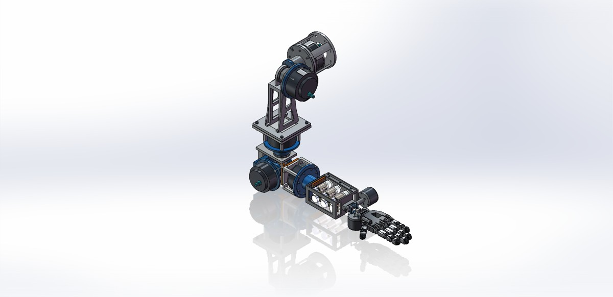
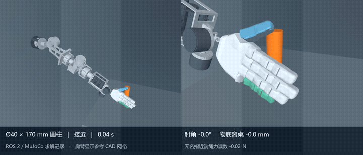
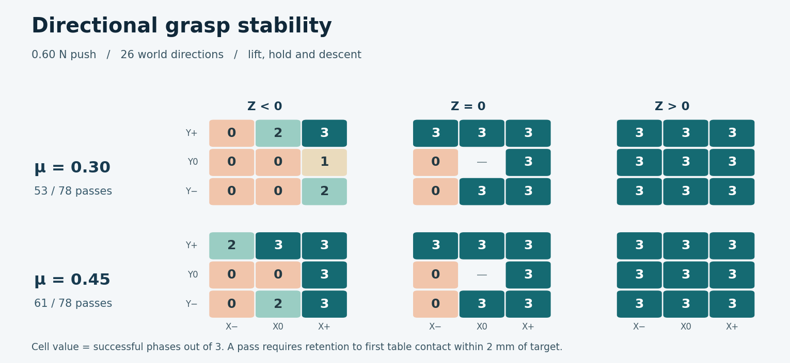
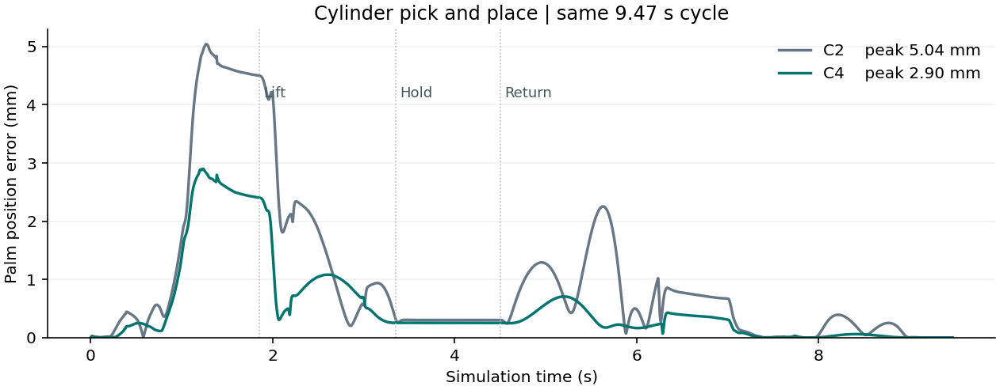
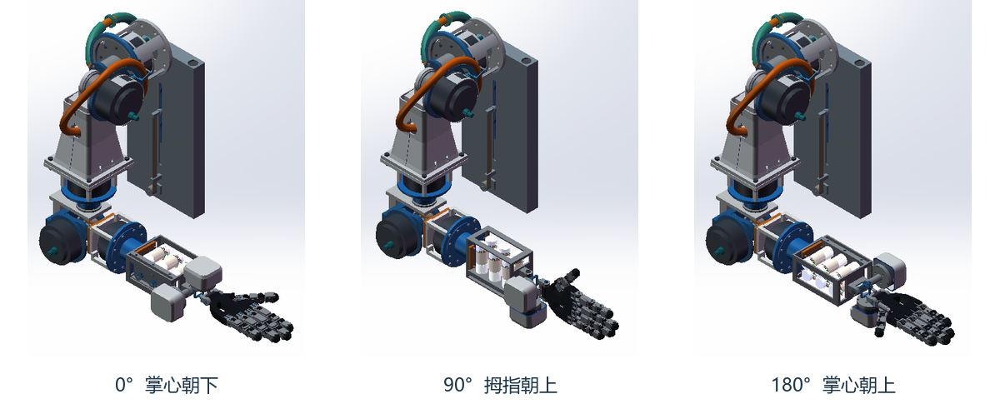
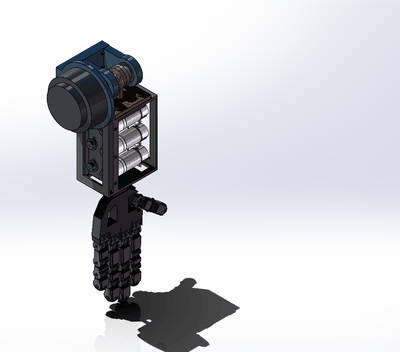
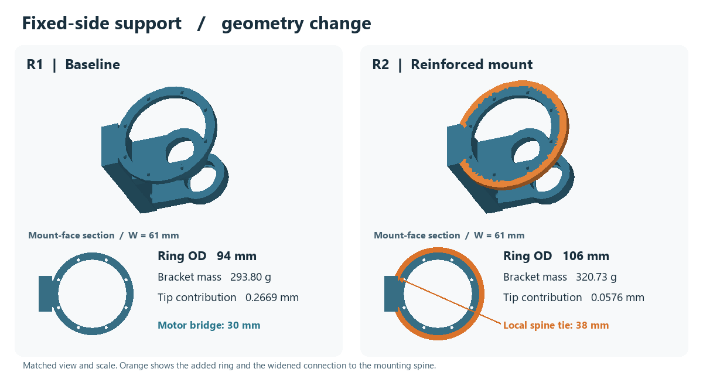
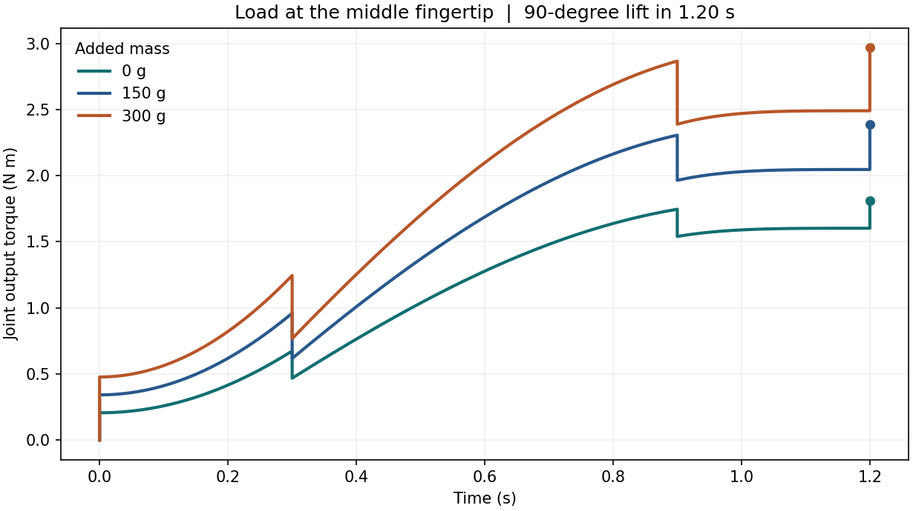

# 七轴仿生机械臂

**从腱绳传动设计到抗扰抓放控制**　·　[English](README.md)　·　[复跑指南](studies/seven-axis-control-c4/README.md)

七个关节控制手臂姿态，六路驱动控制五指手。本项目用 SolidWorks 设计结构，用 MuJoCo 检验手臂能否把物体从桌面拿起，经受扰动，再送到指定触点。

| 整臂装配 · SolidWorks | 圆柱抓放 · MuJoCo |
|:---:|:---:|
| [](docs/full-arm-r4.md) | [](studies/seven-axis-control-c4/media/cylinder.mp4) |

[圆柱抓放](studies/seven-axis-control-c4/media/cylinder.mp4) · [小球抓放](studies/seven-axis-control-c4/media/sphere.mp4) · [七轴 CAD 动作](assets/full-arm-r4/motion.mp4)

## 球受推后，手能否把它放到指定点？

对同一颗 **直径 40 mm、质量 33 g** 的球，从 26 个方向分别在抬升、高位保持和下降时推一次。保持手指动作一致，推力峰值为 **0.60 N** 时，把球与手套的仿真摩擦系数从 **0.30 调到 0.45**，通过数从 **53/78 增到 61/78**。轻推 **0.10 N** 时，两种设置都通过 **78/78**。通过要求同时满足持球到首次触桌和水平落点偏差不超过 2 mm。



每格对应一个推力方向，数字表示三个阶段中有几次通过。推力含负 Z 分量时，部分方向即使提高摩擦也会掉球。[抓法修改与掉球分析](studies/ball-side-c9/README.md) · [214 组逐项对照](studies/ball-side-c9/evidence/matched_045.csv)

## 圆柱抓放的轨迹误差

两版执行相同的 9.47 秒抓放动作。加入惯性前馈、分轴调整控制刚度并修正放置指令后，手掌轨迹和圆柱落点更准，保持阶段圆柱的移动幅度略有增加。

| 圆柱抓放仿真 | 优化前 C2 | 优化后 C4 |
|---|---:|---:|
| 手掌轨迹最大误差 | 5.04 mm | 2.90 mm |
| 手掌轨迹均方根误差 | 1.65 mm | 0.89 mm |
| 圆柱最终落点误差 | 3.47 mm | 0.36 mm |
| 保持阶段圆柱移动幅度 | 0.49 mm | 0.62 mm |



## 在自己的电脑上复跑

安装 64 位 Python 3.11 和支持 C++17 的 g++，在仓库根目录运行。首次执行会安装依赖并生成两版误差曲线和逐时刻数据。

| Windows | Linux |
|---|---|
| `py -3.11 run_cylinder.py` | `python3.11 run_cylinder.py` |

[运行说明与验收标准](studies/seven-axis-control-c4/README.md) · [ROS 2 轨迹动作接口](studies/seven-axis-control-c4/trajectory_action.py)

## 设计与实验记录

| 想了解什么 | 直接查看 |
|---|---|
| 七轴怎么连接，驱动和载荷如何传递 | [整臂关节布局](docs/full-arm-r4.md) · [肘部受力与刚度](docs/mechanics.md) |
| 手指如何发现打滑并收绳 | [虚拟触觉布置](studies/seven-axis-tactile-c5/README.md) · [两指补偿](studies/seven-axis-reflex-c6/README.md) · [收绳时序对照](studies/seven-axis-ball-c7/README.md) |
| 球为什么会掉，落点怎么量 | [首次触桌](studies/ball-placement-c8/README.md) · [侧推与摩擦对照](studies/ball-side-c9/README.md) |

张一展确定设计目标、载荷工况和验收要求，并推进方案评审。建模、计算、求解与项目整理使用工具辅助。公开结果来自 CAD 和仿真，实物表现待测。[贡献与授权](docs/sources-and-rights.md)

<details>
<summary>展开完整版本沿革、肘部计算和有限元记录</summary>

## 机械结构如何迭代

**C2 · ROS 2 七轴抓取控制。** 小球与直立圆柱从桌面抓起、举至 100° 并放回。提供完整动作、掉球对照、三种控制律的匹配试验和复跑入口。[查看控制项目](studies/seven-axis-pick-place-c2/README.zh-CN.md)

**R8.9 · 小指参与抓球。** 小指指根内收 18°。从桌面抓起 Ø40 mm、33 g 球并抬到 100° 后，仿真末态由拇指、食指、中指和小指共同承力。 [查看动作回放、指根参数 和逐指受力对照](studies/little-finger-r89/README.md)

**R8.8 右手翻掌修正** · 从掌心朝下翻到朝上时，拇指现在向上经过握手姿态。SolidWorks 往返共检查 38 个采样姿态，均未检出实体相交。[修改原因、验证范围与逐角度记录](studies/right-forearm-r88/README.md)

[](studies/right-forearm-r88/README.md)

**R8.4 肩部线束回收** · 五条联动路径在目标阻力下保持张紧。高阻力时，即使每程放慢到 8 秒，途中仍会松出约 35 mm。实际阻力待测。[整臂实图、回程曲线与可复算数据](studies/shoulder-return-r84/README.md)

**R7 肩部线束** · 保留第一肩轴 −90°～+90°、第二肩轴 0°～90°。查看原碰撞位置在 25 mm 下垂偏移时的重新测量。[走线修改与行程验证](docs/shoulder-harness-r7.md)

**R6 肩部线束** · 按设计走线时，70 个采样姿态均无实体干涉。线束向下偏移 25 mm 时，两个极限姿态发生碰撞。[肩部线束评审](docs/shoulder-harness-r6.md)

**R5 肩部扩大行程** · 第一轴 −90°～+90°，第二轴 0°～90°。[极限姿态、SolidWorks 干涉检查与线束余量评审](docs/shoulder-r5.md)

**R4 整臂基础结构** · 贴身体的第一肩轴穿过安装圆盘中心，外侧第二肩轴与它垂直。视频展示手指张开时，七个关节分别动作和整臂联动。[观看 SolidWorks 演示（MP4）](assets/full-arm-r4/motion.mp4) · [查看关节布局与验证数据](docs/full-arm-r4.md)

[](docs/full-arm-r4.md)

[R3 机器人上臂安装版三轴肘部](docs/three-axis-elbow.md) · 左右摆单元位于肘上方，摆动时肘中心保持固定。查看实际 CAD 姿态、干涉采样与水平保持力矩。

[English](README.md) · [硬件授权说明](docs/sources-and-rights.md) · [计算、边界条件和网格收敛](docs/mechanics.md)

[固定浅凹拇指指腹：CAD 与撤支撑对照](docs/fixed-thumb.md) · 对 Ø20 mm、33 g 球，双侧接触从 0.050 s 延至 0.084 s；33 g 与 150 g 两组均在手臂下垂时掉落。

[调整取球位置与拇指对掌角后的抬臂试验](docs/pickup-pose.md) · 同样从张开收绳，一组调整将最终脱离从 0.070 s 延后到 0.168 s；拇指在 0.022 s 已首先松开，球仍在抬到水平前掉落。

[观看 SolidWorks 整臂开合三遍（MP4）](assets/arm-hand-motion.mp4) · [打开在线计算实验](https://colab.research.google.com/github/pyuyan0057-jpg/robot-elbow-portfolio/blob/main/notebooks/elbow_lab.ipynb) · [双指收绳与支撑转移求解重放](assets/pinch-replay.gif)

整臂视频展示装配运动。关节跟踪由动力学闭环仿真计算，双指抓取由接触平衡与局部稳定性模型单独检验。

**让球自由滚动再抬臂，结果怎样？** 从下垂姿态撤去支撑后，Ø20 mm、150 g 等效球沿指腹移动并伴有滑动，短暂碰到拇指末节。在带手部硬件碰撞体的仿真中，球于 **0.108 s** 最终脱离两指，肘部仅抬起 **1.22°**。[观看自由球求解回放](assets/free-ball-lift.mp4) · [查看工况、判据和复算方法](docs/free-ball.md)

- **负载估错后能否抬准？** 实际指端加载 300 g、控制器按 150 g 补偿时，带积分控制把末段平均绝对角度误差由 1.85° 降到 0.011°。在另一项外扰试验中，同一组积分参数使恢复时间由 0.137 s 增至 0.468 s。[11 个工况的结果](examples/control-cases.csv)
- **捏球后能否抬起？** 将 158 个手部实体换算到持球姿态后，球心沿前臂方向距肘轴 270.53 mm。球心施加 150 g 等效载荷时，水平保持需要 2.196 N·m。原接触位置在水平方向通过校核，下垂时则有约 0.367 N·mm 重力矩无法由同一对理想点接触抵消。[肘角与抓取结果](data/pinch-angle-screen.csv)
- **下一克材料加在哪里？** 固定支架加强增加 14.75 g，其弹性变形引起的手端下沉减少 0.02154 mm。运动侧转接件加强增加 5.03 g，对应下沉减少 0.05756 mm，水平保持扭矩增加 0.00130 N·m。[结构与控制对比表](data/candidate-tradeoff.csv)

[收绳调校对比图](assets/pinch-spring-comparison.png) · [闭环跟踪曲线](assets/elbow-tracking.png) · [模型、工况与验证范围](docs/controls-and-grasp.md)

单自由度肘关节带动已有五指手和六驱动前臂，从下垂抬到水平。中指端另加 150 g 时，水平保持需要 **2.390 N·m**。在归档静力工况下，加宽固定侧支架后，该支架引起的中指下沉由 **0.2669 降到 0.0576 mm**。

<a href="assets/cad-lift.gif"></a> <a href="assets/bracket-comparison.png"></a>

*左图来自实际 SolidWorks 装配运动。右图采用相同视角和比例，橙色标出新增环体和背脊连接。环外径从 94 增至 106 mm，新增的 26.93 g 留在上臂固定侧。点击图片可查看大图。*

## 独立肘部扭矩复算

在仓库根目录用 Python 3.11–3.14 和 pip 运行。计算和绘图无需 SolidWorks，可在无图形界面的环境中完成。[核验环境和命令](docs/verification.md)

```sh
python -m venv .venv
# Windows PowerShell
.\.venv\Scripts\Activate.ps1
# macOS / Linux: source .venv/bin/activate
python -m pip install -r requirements.txt
python calculate.py --payload-g 150
python calculate.py --payload-g 300
```

如 PowerShell 限制环境激活，创建环境后可直接使用 `.\.venv\Scripts\python.exe` 执行安装与计算。终端打印保持扭矩、抬升峰值、峰值时刻和最高转速。每个工况写入独立的 `outputs/payload-<质量>g-<参数指纹>/`，包含扭矩曲线 PNG、时序 CSV、输入快照和结果摘要。相同输入会更新同一组输出。

```sh
python calculate.py --payload-g 300 --payload-position-mm 350 0 -11 --lift-time-s 1.5 --design-factor 1.8
python -m unittest discover -s tests -v
python examples.py
```

## 三个工况

空手运动组估算 **1.60106 kg**，水平重力臂 **115.18 mm**。U 沿抬平时的前臂指向手端，V 向上，W 沿肘轴；默认中指测点为 (395.214, −0.413, −10.956) mm。负载同时进入重力矩和绕肘轴惯量。加速、匀速、减速分别占抬升总时间的 25%、50%、25%。设计系数用于选型余量。

| 手端另加载荷 | 水平保持 N·m | 抬升过程峰值 N·m | 1.5 倍设计保持 N·m | 最高转速 rpm |
|---:|---:|---:|---:|---:|
| 0 g | 1.80847 | 1.74634 | 2.71271 | 16.67 |
| 150 g | 2.38983 | 2.30773 | 3.58475 | 16.67 |
| 300 g | 2.97119 | 2.86912 | 4.45679 | 16.67 |

默认 1.20 s 抬升，过程峰值出现在 0.90 s、75° 的匀速末端。停稳后重力力臂最大，因此水平保持值高于运动阶段峰值。150→300 g 的保持增量独立手算为 **0.150 × 9.80665 × 0.3952143649 = 0.58135934 N·m**，自动测试按未舍入值和 **10⁻⁹ N·m** 容差核对。[工况表 CSV](examples/cases.csv)



## 结构决策与结果边界

电机固定在上臂，两只外置轴承承受前臂重量，滑块传递驱动力矩。150 g 设计保持需求为 3.585 N·m，AK60-6 的额定输出 3 N·m，AK70-10 的额定输出 8.3 N·m。零速长期保持能力还需相应散热条件下的温升数据。[侧视受力图](assets/free-body.png)

同一静力工况下，支架估算质量由 **293.80 增至 320.73 g**，支架引起的中指下沉降低 **78.4%**。R2 支架和转接件两项贡献合计约 **0.179 mm**。齿轮箱、轴承、前臂等柔度仍需单独获得。CLI 修改负载只更新动力学；仓库中的有限元数据来自原先完成的九项研究。[网格收敛与反力 CSV](data/mesh-convergence.csv)

申请人确定目标、载荷工况和验收要求，推进方案评审；建模、求解、代码与展示资料使用工具辅助。项目为数字样机，未做实测。计算代码使用 MIT 许可。硬件设计文件按需评审，使用项目设计进行商业生产请先联系作者取得书面许可。[来源与授权范围](docs/sources-and-rights.md)

</details>
