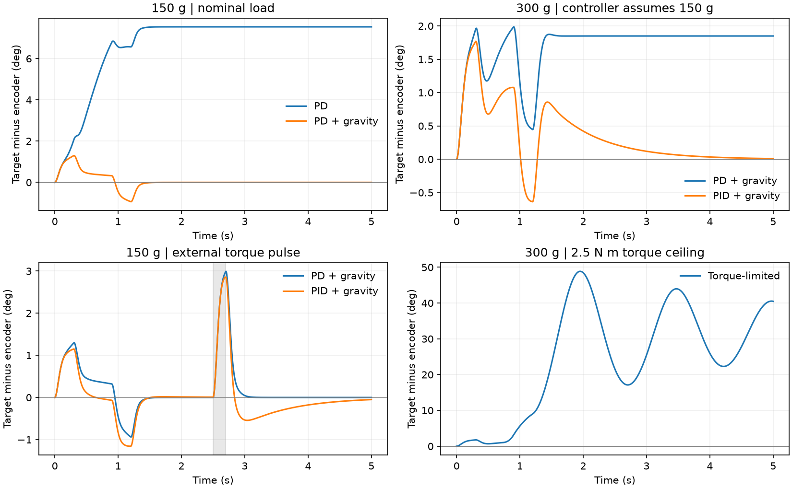
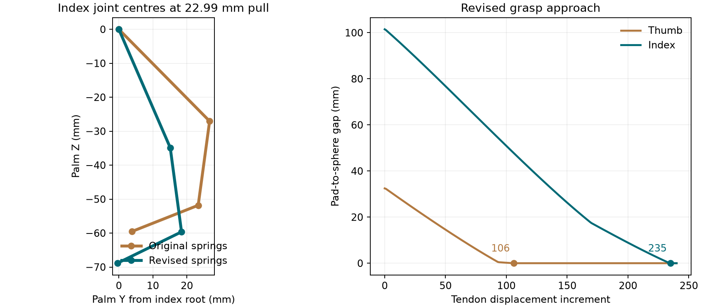

# From actuator sizing to closed-loop lifting

The joint simulation integrates the applied torque to obtain angle and speed. An ideal angle encoder gives the controller its only plant measurement. Velocity comes from filtered differences of successive readings. The reference moves from vertical down to horizontal in 1.2 s. Gravity and inertia come from the R2 mass ledger, with reflected rotor inertia included in the closed-loop plant.

[Original SolidWorks assembly demonstration, three cycles (MP4)](../assets/arm-hand-motion.mp4) · [Solved tendon approach and support transfer (GIF)](../assets/pinch-replay.gif) · [Run the notebook in Colab](https://colab.research.google.com/github/pyuyan0057-jpg/robot-elbow-portfolio/blob/main/notebooks/elbow_lab.ipynb)

## Elbow controller

| Test | Result in the model |
|---|---|
| 150 g nominal fingertip payload | PD alone leaves 7.54° mean absolute error over the final quarter-second. Accurate gravity compensation removes the ideal-model offset. |
| Plant carries 300 g, controller assumes 150 g | The hold error falls from 1.8495° with gravity-compensated PD to 0.0111° with conditional integral action. |
| External −1 N·m applied from 2.5 to 2.7 s | After release, gravity-compensated PD returns to the ±0.5° band in 0.137 s. With the tested integral gain it takes 0.468 s. Recovery must persist through the recording with at least 0.2 s left. |
| 300 g and 2.5 N·m output ceiling | The mechanism requires 2.971 N·m at horizontal rest. The limited plant ends the run about 39.4° below target. |



Design assumptions include a 1 ms sample, 6 ms velocity filter, 12 ms actuator time constant, viscous damping of 0.045 N·m·s/rad and a nominal ±5 N·m command ceiling. These represent an illustrative joint servo. Model-identification and thermal test data would be needed for hardware deployment. The C++17 replay recomputes velocity, gravity, each integral update, the requested torque and the clipped command from the same encoder inputs. It is a host-side comparison, with 5,001 ticks per case and a numerical difference limit of 1e−9 in each compared channel.

```sh
python elbow_control.py
python check_controls.py
python grasp_lift.py
```

The first command generates the original logs for all 11 runs, the plot and integration-refinement checks. The second requires a C++17 compiler on PATH (g++ by default). The third runs the registered-ball transport demand screen. [Controller summary](../examples/control-cases.csv) · [Reference code](../elbow_control.py) · [C++ replay](../controls/replay.cpp)

## Can the original pinch survive the lift?



At the same 22.99 mm index pull, changing the three spring rates redistributed flexion from 45.4/52.3/60.7° to 66.6/15.8/71.6°. In the revised 240-increment approach, the thumb pad reaches the 0.001 mm gap threshold at increment 106 and the index pad at 235. The plots map joint centres and report solved gaps. [Approach data](../data/pinch-approach.csv)

Transforming 158 hand bodies to the grasp pose places the ball centre at U = 270.53 mm from the elbow axis along the horizontal arm. A 150 g equivalent point load there gives 2.196 N·m horizontal holding torque, compared with 2.390 N·m for the previous open-hand load at U = 395.21 mm. Rigid component masses are retained from the original ledger. Deforming tendon and spring corrections use archived tessellations. [Registered model parameters](../data/registered-pinch.json)

The two points of contact cannot generate a couple about the line joining them. At 0° elbow elevation, gravity produces a residual of magnitude 0.367 N·mm about that line. Increasing either tendon tension at the same contact locations cannot cancel that residual. Seven native assembly angles and four additional samples near horizontal were tested. Only the horizontal sample admits equilibrium at the archived fixed contacts and spool strokes. Its minimum friction coefficient in the 16-sided cone approximation is about 0.300, against the assumed 0.35. A rolling-contact small-disturbance check at that equilibrium has positive restoring stiffness. The model does not predict where a free ball might roll next. [Angle-by-angle equilibrium and local stability](../data/pinch-angle-screen.csv)

The dynamic screen asks what moment would be required **if the ball followed the arm**. Peak demands are 0.366, 0.383 and 0.499 N·mm for 2.4, 1.2 and 0.6 s lifts. These trajectories quantify the contact capability that a revised grasp would need. The animation above demonstrates assembly motion only. [Dynamic screen results](../examples/registered-lift.csv)

### What would a finite pad contact change?

An exploratory static calculation allows each pad to transmit a twisting moment. For a circular patch with uniform pressure, the pure-twist bound is (2/3) μ N r. A convex mixture of 16 tangential and two pure-twist rays shares the friction capacity. Couples act on the ball, the finger joints and the thumb opposition axis. Friction was fixed at 0.35 and tendon tension capped at 25 N. Across assumed effective patch radii of 0.25, 0.5, 1, 2 and 3 mm, retuning tensions admits equilibrium at three of seven sampled angles (60°, 75° and 90°). Locked nominal tensions admit only 90°. Patch dimensions are hypotheses; pad tests and a model with migrating contact points would be needed to claim stable transport. [All 84 cases](../data/soft-pad-screen.csv)

## Does tension feedback fix that loss of equilibrium?

In a separate horizontal bench simulation, imposed rest-length drift reaches 0.15 mm at the index and 0.08 mm at the thumb. Both mode comparisons start at the archived target tensions. The controller samples quantized 0.02 N signals every 5 ms and limits spool velocity to ±1.5 mm/s. After two seconds, fixed spools leave errors of 1.50 and 0.80 N. Feedback reduces these to 0.0022 and 0.0054 N.

At the exact original contact points and joint angles, only 1 of 81 sampled feedback states and 17 of 81 fixed-spool states admit exact static equilibrium. Tiny independent tension errors also change joint equilibrium. These are diagnostic sample counts; grasp success or slip probabilities require different evidence. Future work can test moving contact points or finite pad contact patches. [Feedback summary](../data/feedback-summary.json) · [Fixed spool trace](../data/fixed-tension.csv) · [Feedback trace](../data/feedback-tension.csv)

## Where does added material help most?

The native SolidWorks Simulation studies apply the same historical horizontal fingertip load, fixtures, virtual fingertip and section evaluation method to each part and its own baseline. The alternatives are individual substitutions. Table values refer to the fine mesh.

| Candidate | Added mass | Part contribution to fingertip sag, before → after | Section stress, before → after | Change in horizontal holding torque |
|---|---:|---:|---:|---:|
| Further strengthen fixed motor ring and spine | 14.75 g | 0.05759 → 0.03605 mm | 4.388 → 3.053 MPa | 0 |
| Widen moving adaptor web | 5.03 g | 0.12179 → 0.06423 mm | 6.384 → 3.091 MPa | +0.00130 N·m |

The adaptor saves 0.01144 mm of mapped sag per gram added, approximately 7.8 times the fixed bracket's gain per gram. On the original 150 g fingertip tracking case with unchanged gains and gravity estimate, the adaptor increases lift RMS error from 0.69771° to 0.69773°. The final mesh refinement changes candidate sag by 0.27% and 0.40%, and section stress by 2.95% and 4.41%, respectively. Local stress is reported at the common comparison section. Bearing play, gearbox compliance and forearm elasticity remain outside these submodels. [Mesh and reactions](../data/structure-mesh-comparison.csv) · [Structural and control trade-offs](../data/candidate-tradeoff.csv)

The baseline and each individual candidate were reopened from separate SolidWorks assembly copies. Each resolved 263 active component references and rebuilt at 0°, 15°, 30°, 45°, 60°, 75° and 90°. No solid-volume interference was reported in the 21 sampled poses. Manufacturing tolerances, assembly access and swept clearance between samples still require review. [Assembly check records](../data/assembly-fit.csv)
