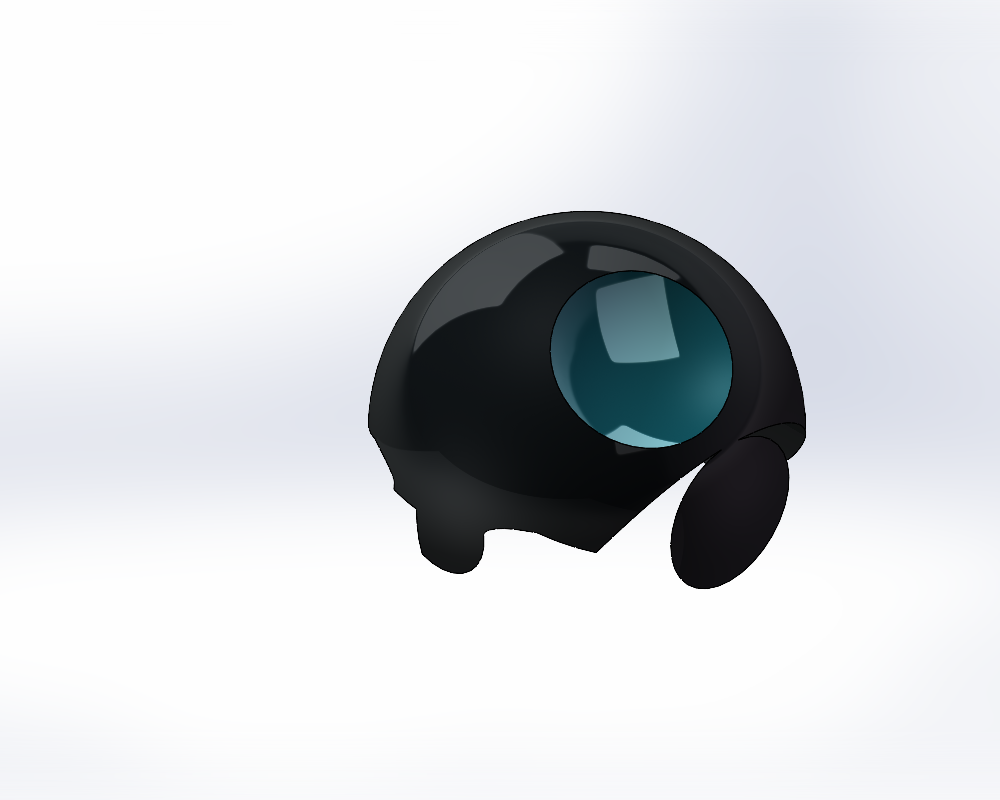
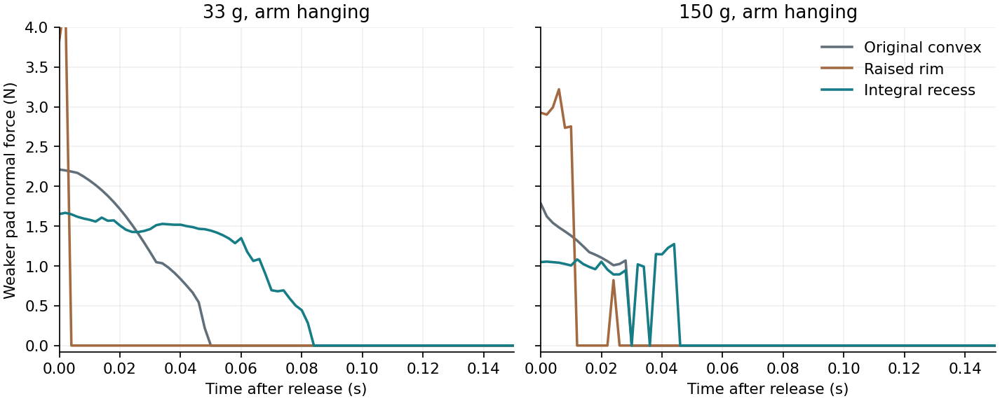

# 固定浅凹拇指指腹 · 下垂撤支撑试验

**结构已做到零件上，抓取验收未通过。** 最终浅凹面直接做在原拇指指腹上。下垂撤支撑后，Ø20 mm、33 g 球的双侧连续接触由 0.050 s 延至 0.084 s，150 g 等效球在 0.030 s 失去一侧接触。两种载荷均在肘部尚处于下垂姿态时掉落。



## 指腹结构与 CAD 核验

原指腹外表面以 R9.2 mm 球面近似。选用原取球位置试验中的调整 A，两指张开、拇指对掌 32.75°，球心相对归档位置平移 (+0.69, −0.59, +2.28) mm。第一版在凸面上加出 Ø14 mm 凹缘，收绳时球偏在凹口一侧。33 g 工况下撤支撑瞬间的拇指法向力合计达 12.43 N，但 0.004 s 已中断双侧接触。增大的初始接触力未能提供持续保持。

最终版缩小开口，直接在指腹切出 **Ø8 mm、R8.3 mm 的球凹**。从口缘平面到凹底为 **1.027 mm**，与 Ø20 mm 球配合时允许球靠在口缘。使用原指腹与拇指末节的安装位置，组件中没有新增可拆件。按原指腹假定密度 1.15 g/cm³，去除材料约 **0.0573 g**；相应质量和一阶质量矩已更新到最终版动力学模型。

在 SolidWorks 2023 中，新零件重开并重建，检查到一个实体及规定半径和位置的球面。独立持球展示总装重开后，159 个启用组件均从工作副本解析。总装保存的是归档装配姿态。沿凹轴在原零件三角化几何上以 13 个半径、48 个方位采样，最终方案凹面至背侧材料边界的最小轴向余厚约 1.23 mm。该值仅代表此方向的离散采样；真实材料的磨损、粘接和强度尚无实物验证。

## 同条件撤支撑

| 指腹 | 33 g 首次失去双侧接触 | 33 g 落到接球平面 | 150 g 首次失去双侧接触 | 150 g 落到接球平面 |
|---|---:|---:|---:|---:|
| 原凸指腹 | 0.050 s | 0.444 s | 0.030 s | 0.414 s |
| 第一版突出凹缘 | 0.004 s | 0.394 s | 0.012 s | 0.362 s |
| 最终一体浅凹面 | 0.084 s | 0.466 s | 0.030 s | 0.398 s |



两组最终版标称工况都是拇指先失去接触，此时食指分别仍有 **0.39 N、1.35 N**，球心已相对手掌移动 **5.59 mm、2.58 mm**。终点两指支撑力均为零，接球平面分别承担 **0.324 N、1.471 N**。[三个版本的时间序列](../examples/fixed-thumb-traces.csv)

- 各组使用相同的取球点、关节弹簧、固定收绳量、25 N 指段张力检查值和标称摩擦系数 0.35。球质量配入对应的肘部重力补偿。两指从张开开始，0.50 s 收绳、等待 0.35 s，然后立刻撤去球的外部支撑，要求先在下垂姿态独立夹持 1.0 s。
- 每 2 ms 检查双侧指腹力均大于 0.01 N、没有手部硬件或地面托球，且张力在限值内。最后 0.25 s 还要求球相对手掌的速度低于 2 mm/s、相对自转低于 0.2 rad/s，肘角距目标小于 1°。通过后才接续 1.2 s 抬升和 2 s 水平保持。结果表中空白的 `lift_pass` 表示该工况未进入抬升。
- 球可自由平移、自转、滑移与再接触。为保留凹形，动力学模型用多个凸扇区近似凹面，中央支撑体止于凹底以下；其余手部硬件沿用 134 个 CAD 凸碰撞体。公开版仅计算两指指腹。真实软垫形变和接触斑尚未标定。[MuJoCo 接触模型](https://mujoco.readthedocs.io/en/3.3.7/computation/index.html#collision-detection)
- 从 24 个圆周分区、4 个径向分区、0.250 ms 步长，加密到 64 个圆周分区、10 个径向分区、0.0625 ms。33 g 工况最终落到接球平面的时刻为 0.466–0.468 s；150 g 为 0.398 s。首次中断时刻对离散方式更敏感。另做摩擦系数 0.25、0.50 及球心沿掌部 Y 轴偏移 +0.5 mm 的试验。20 个验收与敏感性工况均未通过下垂保持。[全部结果](../examples/fixed-thumb-cases.csv) · [上一轮取球点对照](pickup-pose.md)

## 复算公开模型

使用 Python 3.11，在仓库根目录运行。轨迹和摘要写入 `outputs/thumb-cup/`。材料去除量来自私有原生 CAD；公开几何为求解用简化模型。

```sh
python -m pip install -r requirements-free-ball.txt
python thumb_cup.py --mass-g 33 --convex
python thumb_cup.py --mass-g 33
python thumb_cup.py --mass-g 150
```
