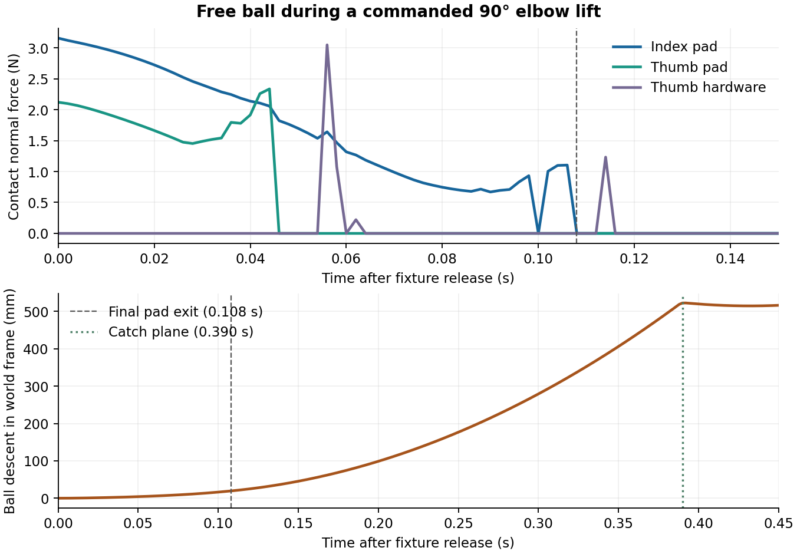

# 自由球抬臂试验 · Free-ball lift

**球在手臂刚起抬时掉落。** 在指定取球姿态锁住卷筒，撤去临时支撑，允许 Ø20 mm 球在三维空间平移和自转。带 134 个手部硬件碰撞体的标称工况中，球最后离开两侧指腹时距撤支撑 **0.108 s**，肘角仅 **1.22°**；落到下方接球平面时为 **0.390 s**。手臂随后继续向水平抬升。这里的 **150 g** 是沿用前次校核的等效质量，摩擦和接触刚度为模型假设。

[播放求解轨迹 MP4](../assets/free-ball-lift.mp4) · [下载标称轨迹 CSV](../examples/free-ball-cad-trajectory.csv) · [比较全部 18 个工况](../examples/free-ball-cases.csv)



录像左侧是固定于世界的侧视投影，右侧是随掌运动的局部投影。两边按同一时间戳读取球心、姿态和指腹位置；深蓝为食指、绿色为拇指、橙色为球。开头放慢，时间读数为仿真秒。手指硬件只参与接触求解，画面使用简化外形。

## 撤支撑后的经过

| 标称仿真时刻 | 记录 |
|---|---|
| 0 s | 两指已接触，食指与拇指法向力分别为 3.16、2.12 N，绳张力分别为 15.58、4.38 N。关闭取球定位约束，开始抬臂。 |
| 0.046 s | 拇指指腹首次失去接触。此时球心相对手掌已移动 5.84 mm，食指仍有约 1.82 N 法向力。 |
| 0.056 s | 球第一次碰到拇指末节的硬质几何。 |
| 0.100–0.108 s | 两侧指腹首次同时失去接触，短暂再接触后最终分离。分离时球心相对手掌已移动 21.70 mm。 |
| 0.390 s | 球抵达肘轴下方 0.80 m 的诊断平面。保持阶段末，平面支撑约 1.471 N，两指均无接触。 |

食指和拇指接触点在各自指腹表面的累计迁移量约为 8.8、2.4 mm，接触处存在相对切向滑动。模型允许球滚动、打滑和再次接触。局部接触的开闭时刻和迁移量对积分步长比最终分离时刻更敏感。

## 模型与判据

- 使用注册后的持球姿态、两处半径 9.2 mm 的解析球面指腹和锁定的卷筒收绳量。0.35 s 准备阶段用临时定位约束扶球，使指节在腱绳、复位弹簧和接触载荷下就位。释放后五个屈曲关节按动力学运动，拇指对掌角锁定。初始球在两指间，试验研究交接和搬运。
- 球有六个自由度。质量 0.150 kg，半径 10 mm，标称惯量取均匀球的 0.4 m r²。接触采用 MuJoCo 3.3.7 椭圆库仑摩擦锥，μ = 0.35，法向响应时间 3 ms，允许滚动和滑动；接触点无单独的扭转或滚阻力矩。真实指腹斑面积、材料滞后及摩擦尚未测量。[MuJoCo 接触力与摩擦锥](https://mujoco.readthedocs.io/en/3.3.7/computation/index.html#contact)
- 肘部从下垂启动，参考轨迹在 1.2 s 内转过 90°，前后各四分之一时段加减速，之后保持 2 s。控制器继续沿用有球时的重力补偿，标称记录的最终实际肘角为 91.28°。指节质量取自归档，质心惯量按简化杆估算，其余质量归入前臂以匹配整臂的质量、一阶质量矩及绕肘轴惯量。
- 公开模型包含两处指腹。扩展工况加入从归档姿态提取的 134 个手部硬件凸碰撞体，覆盖其余手指及掌部等几何；凸包会填平局部凹槽。绳、簧、腕部和前臂框架均未作为球的碰撞表面。原生 CAD 和硬件碰撞网格保存在项目本地。
- 每 2 ms 记录一次；大于 0.001 N 才记作接触。“最终分离”取最后一次指腹接触后的首个样本。掉落另外要求球落在接球平面，末段 0.25 s 持续由平面支撑、与手分离，且相对掌部位移超过一个球径。若末段始终为双指接触，各侧力大于 0.01 N、相对掌部速度低于 2 mm/s、自转角速度差低于 0.2 rad/s 且未接触平面，归为稳定保持。其余情况保留为未定。

## 哪些假设影响结果

| 改动 | 最终脱离指腹的时刻（自开始撤支撑） |
|---|---|
| 仅公开指腹 / 加入手部硬件 | 0.104 / 0.108 s |
| 积分步长 0.250 / 0.125 / 0.0625 ms | 0.108 / 0.110 / 0.110 s；对应接球时刻均为 0.390 s |
| 摩擦系数 0.25 / 0.35 / 0.50 / 0.85 | 0.100 / 0.108 / 0.122 / 0.134 s |
| 抬升用时 0.6 / 1.2 / 2.4 s | 0.088 / 0.108 / 0.108 s |
| 下垂时用 0.20 s 逐步卸去支撑，卸完才开始抬升 | 0.228 s（起抬后 0.028 s） |
| 单独在水平姿态交接，瞬时 / 0.20 s 撤支撑 | 0.208 / 0.342 s |

此前水平局部稳定性校核从指定接触点和已配平的力系出发。本次从带外部支撑的实际求解初态释放，接触点和受力随时间改变。水平单独释放也掉落，说明这套交接方式没有把球带入先前算出的稳定平衡。18 个确定性工况均掉落；它们用于检查参数敏感性。作为独立数值检查，在无接触、无支撑的自由飞行区间，球心轨迹二阶差分的向下加速度中位数为 9.80665 m/s²。

## 复算与数据约定

在仓库根目录用 Python 3.11 运行公开双指腹版本。标称值约为 0.104 s 脱离、0.386 s 落到诊断平面。第二条求解命令可切换到渐卸支撑；其间线性减小准备阶段末保存的定位反力及力矩。

```sh
python -m pip install -r requirements-free-ball.txt
python free_ball.py
python free_ball.py --transfer-s 0.2 --friction 0.5
python -m unittest discover -s tests -p test_free_ball.py -v
```

程序输出轨迹与 JSON 摘要至 `outputs/free-ball/`。公开 CSV 中的完整标称轨迹来自含硬件凸包的扩展模型，可直接复核接触事件、回放和落地判据。世界 +Y 向下，肘轴为 +X；`world_down_m` 是球心世界 Y 坐标，`palm_*_mm` 是球心在随动掌坐标系内的位置，`*_pad_*_m` 是指腹球心世界坐标，`ball_quat_*` 采用 w,x,y,z 顺序。0.002 s 是轨迹采样间隔；求解积分步长单列在工况表内。
