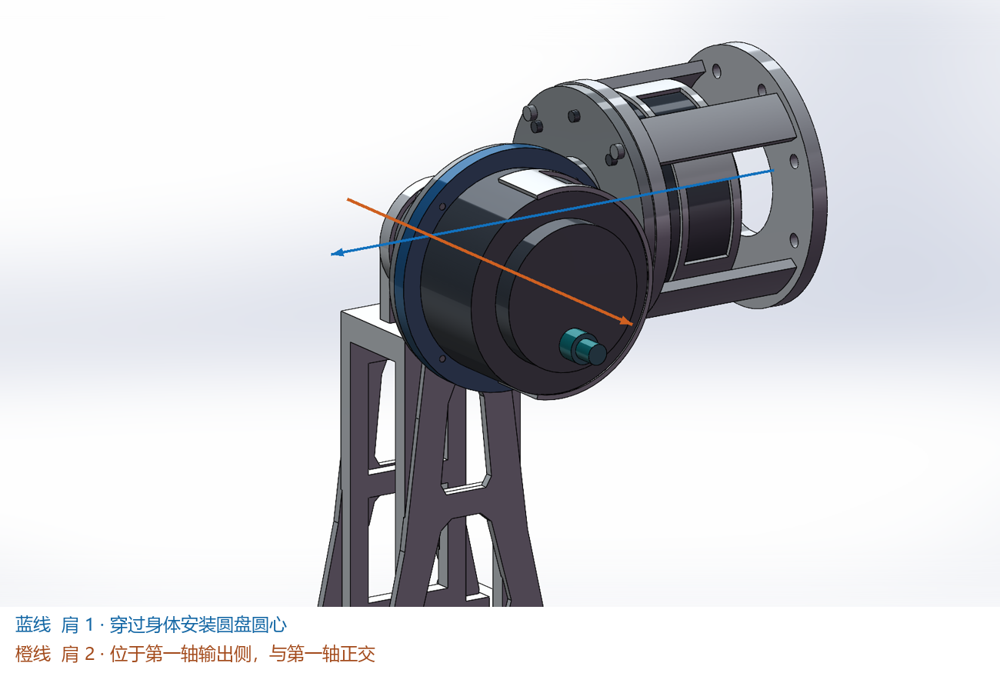

# R4 · 七轴整臂基础结构 / Seven-axis arm

[整臂运动演示 · 1080p MP4](../assets/full-arm-r4/motion.mp4) · [English overview](../README.md) · [中文首页](../README.zh-CN.md)

从身体向外看，第一肩轴垂直安装圆盘、穿过圆心，转动时带着整个外肩一起转。第二肩轴在外侧，与第一轴垂直。安装圆盘外径 124 mm。两台肩电机壳体离身体安装平面的最近距离分别为 30.1 mm 和 130.0 mm。[实测几何记录](../data/full-arm-r4/shoulder-interface.txt)

| 运动位置 | 独立控制的动作 |
|---|---|
| 肩部 | ① 绕贴身法兰轴前后抬臂；② 绕外侧正交轴向侧面抬臂 |
| 肘部 | ③ 屈肘时指尖左右扫；④ 弯曲、伸直小臂 |
| 前臂 | ⑤ 翻掌，让掌心朝上或朝下 |
| 手腕 | ⑥ 手掌上下弯；⑦ 手掌向拇指侧或小指侧偏 |

七轴计数到手腕为止。前臂内另有六路手部驱动。本段 26.27 秒演示来自 SolidWorks 装配视口，手指保持张开。

## What was checked

| Check | Result and scope |
|---|---|
| Independent motion | One mate was commanded at a time. The largest change in any other relative joint angle across the seven trials was below 0.000001°. This verifies independence in the CAD assembly. [Seven trials, degrees](../data/full-arm-r4/independent-control.csv) |
| Solid interference | Nine saved poses, eleven intermediate samples and seven single-axis endpoints gave 27 checks with zero positive-volume intersections detected. This is discrete pose sampling. [20 pose checks](../data/full-arm-r4/native-samples.csv) · [7 endpoints](../data/full-arm-r4/independent-control.csv) |
| Body-side clearance | A conservative geometric bound along the demonstration path gave at least 58.77 mm from moving geometry to the body mounting plane. The torso is represented by that plane. [Segment bounds, mm](../data/full-arm-r4/body-clearance.csv) |
| Gravity load | With an additional 150 g at the index pad, maximum absolute shoulder gravity torques in the archived pose samples were 17.06 and 10.36 N·m. This is a static comparison load. [Shoulder moments](../data/full-arm-r4/shoulder-gravity.csv) · [Wrist moments](../data/full-arm-r4/wrist-gravity.csv) |
| Tendons across the wrist | With drums held and the open-hand preload assumption, the largest predicted passive finger flexion on the 9 × 9 wrist grid was 0.455°. Across the same grid, the smallest modelled wrist-route rope-to-solid clearance was 0.293 mm. [Length and spring estimates](../data/full-arm-r4/tendon-results.json) · [Route samples](../data/full-arm-r4/wrist-route-solid.csv) |

视频展示装配运动。150 g 用于重力矩比较；持球试验结果见[抓取研究](free-ball.md)。本版尚无样机实测。

The project owner specified the shoulder order, independent motions and review criteria. CAD automation, checks and documentation used software and AI assistance. The editable assemblies stay in the private engineering archive. [Sources and hardware permissions](sources-and-rights.md)
