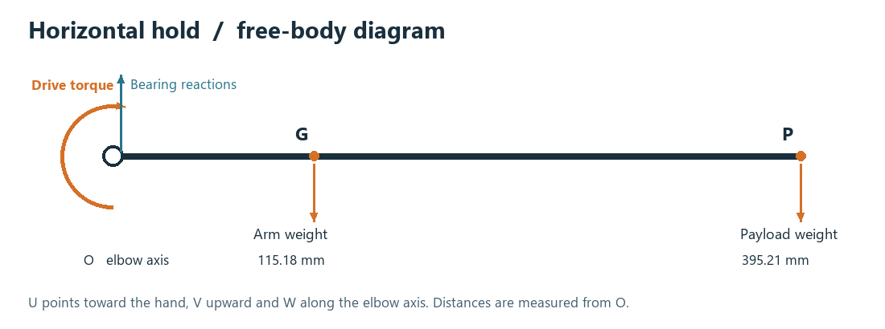

# Mechanics and evidence

## Loads and reference frame

The upper arm is fixed. U points from the elbow axis toward the extended hand, V points up in the horizontal reference pose, and W runs along the hinge. Positive lift angle θ increases from vertical down (0°) to horizontal (90°). Distances in the equations are metres. The archived open hand, locked wrist, six motor drives and forearm frame together weigh an estimated 1.19733 kg with U = 0.15015 m. Including the R2 moving-side elbow hardware gives 1.6010572 kg. The motor case and reinforced yoke belong to the fixed side.

For each mass, take its horizontal-pose coordinates (u,v,w). The net first moments Sᵤ, Sᵥ, S𝑤 are the sums of mass times each coordinate. The mass ledger contains signed changes for the R2 split spindle. Six forearm motors each contribute the manufacturer's 104 g once. The remaining masses use body volume and assumed material density; motor centres use envelope midpoints. The joint-axis inertia includes each body's centroidal inertia plus its parallel-axis term. See the [ledger](../data/moving-mass-ledger.csv) and [calculator defaults](../data/r2.json).

For an added point mass m at (u,v,w), add m(u²+v²) to the joint-axis inertia. Its W offset affects the lateral load split. For total moving mass M and bearing spacing L=0.048 m, horizontal bearing reactions are g(M/2 ± S𝑤/L). These equations assume a rigid spindle, a static horizontal pose and two radial support centres.

## Motion and drive selection

The 90° move uses a symmetric trapezoidal velocity profile. Acceleration, cruise and deceleration occupy 25%, 50% and 25% of the requested time T. Peak speed is (π/2)/(0.75T). The acceleration magnitude is peak speed divided by 0.25T. Joint torque is

**τ = g(Sᵤ sin θ + Sᵥ cos θ) + Jw α.**

At horizontal rest τ = gSᵤ. The motion peak is the largest magnitude across the three moving segments including their one-sided limits. CSV rows at a switch share a time and angle and give distinct acceleration values. The final row is static hold. For each constant-acceleration interval the code checks both endpoints and the possible internal stationary point of gravity torque. This also covers unusual payload positions and braking torque at short lift times. The design factor multiplies the reported magnitudes used for sizing; it leaves the simulated motion and service-load trace unchanged.

Motor torque is estimated as τ/(iη) + Jrotor·i·α. The AK70-10 has a 10:1 reduction; η=0.85 is an assumed equivalent conversion. The estimated rotor inertia is 7.534788×10⁻⁵ kg·m². At 150 g the design holding requirement is 3.585 N·m at the output. The alternative AK60-6 supplies 3 N·m rated, and the selected AK70-10 supplies 8.3 N·m rated. Their listed peak values are 9 and 24.8 N·m. A rated operating point alone cannot establish permissible zero-speed dwell time. External 6002-2Z bearings carry radial reactions because flange off-axis load limits were unconfirmed. Bearing contact, friction, actuator losses under regeneration and controller dynamics require additional data.

## Historical finite-element comparison

The archived SolidWorks Simulation studies use the **same R1 horizontal service load** for both yokes. The fixed rear mounting plane is U = −61 mm. The bearing seats receive 8.0643 N and 9.1219 N downward, and eight tangential forces on the motor bolt circle apply −2.38983 N·m about W. Opposite support reactions balance 17.1862 N and 2.38983 N·m. The R2 split spindle changes service reactions slightly; holding the comparison load constant isolates the bracket change.

Each study uses one linear-elastic 6061-T6 solid, quadratic tetrahedra and an ideal rigid upper-arm face. The fingertip is a **virtual measurement point**. Fitted seat-centre vertical translations and motor-ring rotation are mapped to P=(395.214, −0.413, −10.956) mm. The rotation is fitted on the common motor face at W=64 mm, over a radial band of 39…46.9 mm. The transfer assumes a locked drive and a rigid intervening chain.

| Fixed-yoke metric | R1 | R2 |
|---|---:|---:|
| Mass estimated from native body volume (g) | 293.80 | 320.73 |
| Yoke contribution to fingertip sag (mm) | 0.26690 | 0.05759 |
| Maximum displacement on the yoke itself (mm) | 0.07222 | 0.01694 |
| Comparison-section von Mises stress (MPa) | 11.99 | 4.39 |
| Reaction torque about W (N·m) | 2.38982 | 2.38983 |

The added 26.93 g resides on the fixed side. The smaller sag corresponds to a 78.4% reduction of the **yoke contribution**. Mesh sizes were 3.8, 2.8 and 2.0 mm. The last refinement changes that displacement by 0.05% for R1 and 0.51% for R2. Yoke section stress uses the same spatial region, −34<U<−29 mm and W>57 mm. Whole-body stress peaks near boundaries are mesh-sensitive. The [mesh table](../data/mesh-convergence.csv) includes the peaks, reactions and the separate adaptor study. A simple bending check on the adaptor gives about 6.30 MPa, compared with 6.38 MPa in its final section region.

The unchanged adaptor contributes a further 0.12179 mm in its separate idealized submodel. The two R2 aluminium contributions sum to approximately 0.17938 mm. Bearing play, gear torsion, sliding-coupling contact, bolted joints, forearm and fingers also affect the real tip. No prototype, measured stiffness or full-arm deflection is claimed. Running a different payload with the CLI changes the dynamics outputs only; these archived FEA rows remain tied to their original load case.
