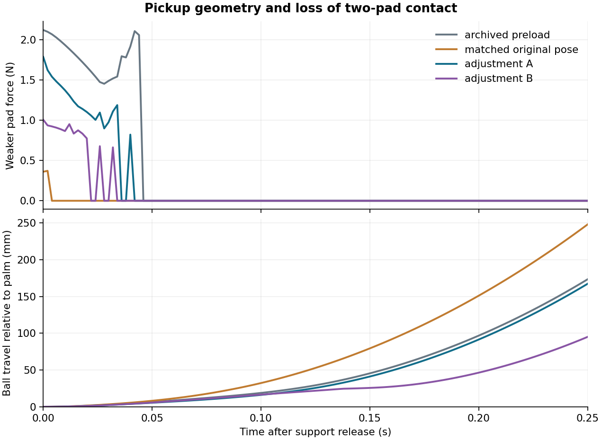

# 调整取球点和拇指对掌角后，能把球抬到水平吗？

**本轮没有找到能从下垂稳定抬到水平的双指取球姿态。** 在相同的张开收绳流程中，将球移向指腹的另一处、适当减小拇指对掌角，可以延后脱离。两组重点复算的姿态仍是拇指先松开，食指短时单侧托球，然后球掉落。第一次中断双侧接触与最后离开两指是两个不同事件。



## 四条实际求解轨迹

球径 20 mm，球的等效质量 150 g，摩擦系数假设为 0.35。偏移量使用随掌坐标系，相对于原球心 **(−42.634, −19.468, −59.627) mm**；下垂时 +Y 向下。表中四组均含原来的 134 个手部硬件凸碰撞体。时刻均从撤去外部支撑起算。

| 条件 | 球心偏移 X / Y / Z（mm） | 对掌角 | 首次中断双侧接触 | 最终离开指腹 | 此时肘角 | 落到接球平面 |
|---|---|---:|---:|---:|---:|---:|
| 上次归档，已预紧的持球姿态 | 0 / 0 / 0 | 33.584° | 0.046 s | 0.108 s | 1.22° | 0.390 s |
| 本轮对照，从张开收绳 | 0 / 0 / 0 | 33.584° | 0.004 s | 0.070 s | 0.31° | 0.352 s |
| 调整 A，优先考察双侧连续接触 | +0.69 / −0.59 / +2.28 | 32.75° | 0.036 s | 0.122 s | 1.83° | 0.394 s |
| 调整 B，优先考察最终脱离 | +3.63 / −3.48 / +4.16 | 31.31° | 0.022 s | 0.168 s | 4.20° | 0.446 s |

旧工况释放时两侧法向力为 3.16 / 2.12 N；本轮用原取球点从张开收绳，释放时只有 0.36 / 0.78 N。比较几何调整的效果，应使用表中第二行作对照。调整 A 使释放时的两侧力达到 2.11 / 1.79 N；调整 B 为 1.25 / 1.01 N。B 第一次失去拇指承托时球心只移动了 1.34 mm。随后即使还有指腹接触，球已无法维持双指夹持。[四组完整时间序列](../examples/pickup-pose-traces.csv) · [原始掉球报告](free-ball.md)

## 怎样选择和验证位置

1. 原掉球轨迹在拇指首次脱离时，球心相对掌部移动约 (−1.26, +3.75, +4.29) mm。先围绕原球心分别试正、负位移及不同对掌角；再沿双侧接触持续较久的方向细化。同时向食指指腹侧扩大搜索，检验更接近侧向相对的姿态。对掌轴和轴心取自原拇指旋转机构，候选角位于归档中已走过的 0–33.584° 区间。
2. 肘部下垂，预先设定对掌角，两个屈曲指从张开开始。球由定位支撑固定；以 0.50 s 同步线性收绳，再等待 0.35 s。达到 24.370 mm（食指）和 14.561 mm（拇指）后锁定卷筒。撤掉定位约束的同时启动原有 1.2 s 抬升和 2 s 水平保持指令。所有指节角度、自由球的平移和自转均由动力学求解。保持原肘控制器、指腹模型及接触参数，以隔离几何调整的影响。
3. 189 次仅指腹的网格与局部筛选，再做 176 次含硬件的筛选和对照，另做 21 次复算、4 次单变量对照。合计 **390 次求解**，包含重复几何、步长变化与对照；这是确定性搜索，没有统计成功率。筛选时分别考察双侧连续承托和最后脱离，选取改变了球心与角度、初始有双侧接触、末次指腹脱离前无硬件托球、释放后指段张力不超过 25 N 的代表方案。
4. 以 2 ms 间隔核对载荷，任一指腹法向力低于 0.01 N 计为双侧接触中断。沿用原报告的 0.001 N 判定最终接触。通过条件要求抬升和保持全程的样本持续有双侧接触，球未借助硬件或接球平面，末段 0.25 s 内球心相对速度低于 2 mm/s、相对自转角速度低于 0.2 rad/s、肘角距水平不超过 1°。各候选均在保持阶段前失去夹持。部分几何在释放后从未产生有效指腹接触，这类落到平面的记录单列为 `missed pickup`。
5. 对调整 B，仅改变对掌角时，最终分离为 0.074 s；仅改变球心时为 0.138 s；一起调整为 0.168 s。同一姿态在 0.250、0.125、0.0625 ms 三个积分步长下的最终分离分别为 0.168、0.166、0.170 s。调整 A 的对应值是 0.122、0.110、0.122 s。另检查了摩擦变化、球心沿三轴分别偏移 +0.5 mm、对掌角减小 0.5°，两组都未稳定保持。[逐工况输入与结果](../examples/pickup-pose-cases.csv)

## 复算和适用范围

在仓库根目录运行公开的双指腹模型。调整 B 的公开版本约在 0.164 s 脱离。公开时间序列另外给出含硬件的结果。原生 CAD 和硬件凸包保存在本地技术归档。新姿态使用既有机构几何，未针对这些新姿态做原生 CAD 装配干涉认证。

```sh
python -m pip install -r requirements-free-ball.txt
python pickup_pose.py
python pickup_pose.py --offset-mm 0.69 -0.59 2.28 --opposition-deg 32.75
python pickup_pose.py --offset-mm 3.63 -3.48 4.16 --opposition-deg 31.31
```

观察范围是固定收绳量、当前指腹曲率和取球时序下的交接与搬运。臂体仍采用原聚合质量与惯量标定，其他三指保持既有姿态。接触使用可移动的球面点接触，未加入额外的抗扭摩擦或滚动阻力；有限接触斑、材料摩擦和软垫形变仍需独立标定。扩大取球点搜索范围并不能代替这项标定。[MuJoCo 接触模型](https://mujoco.readthedocs.io/en/3.3.7/computation/index.html#contact)
