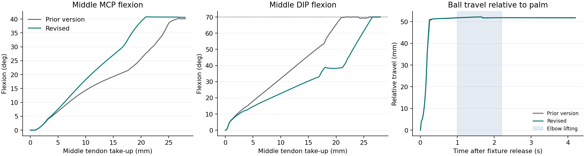
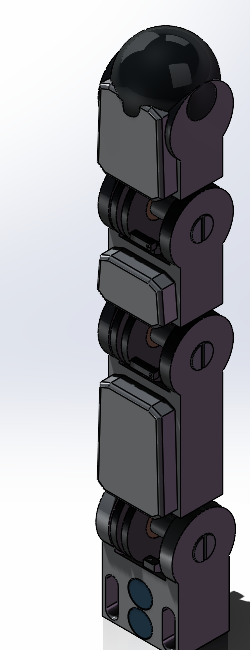

# 无名指防脱件下沉与中指屈曲顺序调整

保留 15° 指根、球移 +5 mm、六路驱动和无名指提前 0.50 s 的设定。新防脱件在叉耳外的突出量为 **0.25 mm**。在相同的 19.6 mm 中指收绳处，中指指根由 24.8° 增到 38.2°，末节从 63.4° 降到 38.2°。**33 g 球的三指抓取仍未通过。** 水平保持结束时，球由硬件托住。150 g 工况没有启动。[上版完整对照](ring-timing.md)

## 防脱件与扭簧

| 位置 | 原方案 | 本版 |
|---|---|---|
| 无名指 MCP | 叉耳总宽 18 mm，螺钉头突出 1.70 mm | 销长 16.90 mm，双端沉座，突出 0.25 mm |
| 无名指 PIP、DIP | 叉耳总宽 17 mm，螺钉头突出 2.20 mm | 销长 15.90 mm，双端沉座，突出 0.25 mm |
| 中指 MCP 复位簧 | Ø0.60 mm 线径，8.25 圈，7.05 N·mm/rad | Ø0.50 mm，8.25 圈，3.40 N·mm/rad |
| 中指 DIP 复位簧 | Ø0.60 mm，4.75 圈，12.02 N·mm/rad | Ø0.60 mm，2.75 圈，20.13 N·mm/rad |

六个定制 M2 一字槽头的法兰均为 Ø5.0 × 0.80 mm，配 Ø5.30 × 0.65 mm 沉座。销端座面与沉座底每侧名义间隙 0.10 mm。螺纹段长 2.60 mm，模型简化为螺纹芯径；销端底孔深 3.20 mm。最薄的 2.50 mm 叉耳在沉座处剩 1.85 mm。Ø5 法兰跨过 Ø4 销孔形成轴向止挡，装在销上，保留叉耳转动余量。凸出量是以**各自叉耳外侧面**为基准的名义 CAD 尺寸。防松、有效攻丝深度、公差堆叠和轴向承载尚待制造设计校核。

中指继续用一根屈曲腱。指根弹簧变软，末节弹簧变硬；中节维持 10.00 N·mm/rad。两件新扭簧均保留 Ø6.4 mm 中径和原安装态的簧腿端点。末节减少两整圈，保持端部相位，其节距从 0.64 调为约 1.11 mm。刚度沿用已有弹簧模型，计入两个 6.5 mm 簧腿。按原始 2 N·mm 预紧假设，指根和末节的预紧转角分别约 33.7°、5.7°。CAD 扭簧表示张开时的安装形状，刚度、预紧及疲劳寿命均未实测。

对比了 20 组保留原末节线径的组合，另做 24 组较粗末节线材的数值筛选。最终保留原簧腿孔能容纳的线径。选择依据是同一收绳量下的关节角和到限位的时刻；仅按撤支撑间隙排序，会选到运动顺序不同的组合。[弹簧筛选明细](../examples/revision-spring-screen.csv) · [等收绳量角度数据](../examples/revision-angles.csv)

## SolidWorks 对照

以实际求解角重建两指 56 个刚性零件。原有 69 个时刻用作等时刻对照，再对组合方案收绳阶段加密。全局记录覆盖 28 × 28 个潜在跨指配对，先用包围盒筛选，再对候选实体求最近距离和相交体积。另对六个改版无名指法兰与中指单独测量，防止其他更近的零件掩盖法兰的真实净空。柔性腱、弹簧变形、加工误差均未计入这项净空检查。[两指全局复核](../examples/revision-clearance.csv) · [新法兰单独复核](../examples/revision-cap-clearance.csv)

组合方案在 **115 个收绳与静置采样姿态**中，六个改版无名指防脱件到中指的最小间隙为 **1.453 mm**，发生在撤支撑前 0.410 s，最近的是中指末节和无名指末关节内侧法兰。若计入两指全部刚性零件，最小间隙仍是 **0 mm**：中指原有的另一颗轴端防脱件与无名指中节贴靠，最大采样相交约 0.00000615 mm³。这个量接近贴合，名义模型没有给出可分配给公差的正余量。

原版最大采样相交为 0.00350 mm³，发生在中指末节与无名指防脱件之间。只改防脱件后，同样 69 个姿态中仍可见中指指腹与无名指中节相交约 0.00219 mm³。新装配的无名指维护子装配（28 件）、中指开指弹簧子装配（31 件）均已重新打开、重建，本地引用齐全，静态姿态未检出实体干涉。整手撤支撑装配为 141 件，记录含食指指腹与球的接触穿入、食指相邻两节及中指轴端与无名指中节的微小穿入。详见本地 CAD 检查记录。

## 自由球抬臂校核

两项改动分别单独求解，再合并求解。四组共用 Ø20 mm、33 g 球、摩擦系数 0.35、中指收绳 28 mm、拇指对掌角 32.75° 和同一取球位置。碰撞网格由新 SolidWorks 零件导出；沿用旧整臂惯量台账以便同条件比较。按原零件密度和网格体积估算，无名指硬件质量减少约 0.85 g，此差值未回填到动力学质量台账。指节之间的碰撞采用硬件凸包近似。

| 方案 | 末节首次达到 69.9°，从开始收绳计 | 撤支撑时中指距球面 | 撤支撑时中指法向力 | 收绳峰值张力 |
|---|---:|---:|---:|---:|
| 上一版 | 0.388 s | 13.54 mm | 0 N | 15.59 N |
| 只改无名指防脱件 | 0.388 s | 13.69 mm | 0 N | 14.90 N |
| 只改中指弹簧 | 0.476 s | 13.42 mm | 0 N | 16.38 N |
| 两项合并 | 0.476 s | 13.43 mm | 0 N | 16.47 N |

组合方案在撤支撑后的 1 s 下垂等待中已失去抓取位置，但继续完成 1.2 s 抬升和 2 s 水平保持，以记录球的最终去向。结束时肘角 90.015°，球相对手掌移开 **51.76 mm**，三指指腹和接球平面的支撑力均为零。接触来自中指中节、末节和食指轴端件。积分步长从 0.25 ms 减半后相对位移为 51.73 mm，结论相同。另在 24～32 mm 范围内检验了八个收绳量；均未通过 33 g 下垂验收。[四组全程与半步长结果](../examples/revision-load.csv) · [主工况 2 ms 序列](../examples/revision-lift-trace.csv)

## 指腹仍差在哪里

在原因对照中，只关闭中指与无名指活动件之间的碰撞，球对硬件的碰撞仍开启。相同弹簧和收绳量下，撤支撑时指根可到 **64.98°**，中指指腹对球有 **0.52 N** 法向力。然而三指同时接触仅出现于 7 个采样点，球在 0.574 s 到达接球平面。把虚拟轨迹放回 SolidWorks，在撤支撑前 0.600 s，中指和无名指的中节实体相交达 364.46 mm³；虽然虚拟撤支撑终态两指仍有 0.603 mm 净空，沿该路径无法到达。下一步应先让两根中节的运动路径错开，再评估球接触后的承载。[行程与原因对照](../examples/revision-stroke.csv)

公开简化模型可用 `python ring_timing.py --lead 0.50 --initial-mm 12 --revised-middle --observe-lift` 复查中指弹簧和收绳响应。其依赖见 `requirements-free-ball.txt`，带硬件凸包的计算结果另行归档。参考 Yale OpenHand 把屈曲腱和回位机构分开调校的做法，本轮分别测试了改变防脱件、改变回位弹簧对同一取球条件的影响；具体尺寸取自本项目原生 CAD。[OpenHand 作者的调校说明](https://github.com/grablab/openhand_node)
