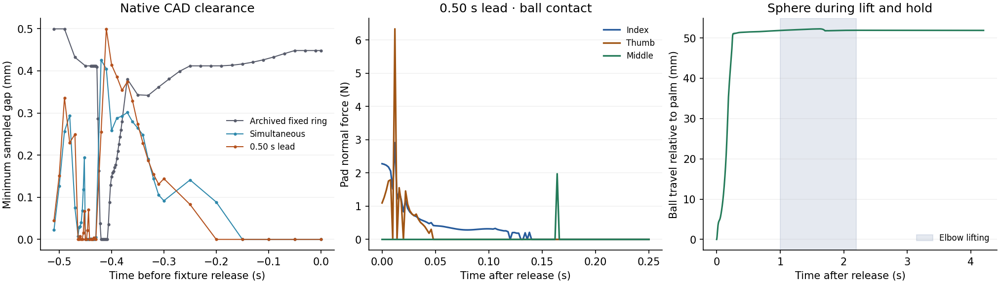

# 15° 锁定中指与无名指提前收绳

**33 g 球未通过三指抬升验收。** 无名指提前 0.50 s 后，收绳阶段的最大腱张力和模型中的邻指接触峰值都下降，但撤支撑时中指指腹距球面仍有 13.54 mm。继续抬臂作诊断，球在水平保持结束时已离开抓取位置，靠指节与轴端件承托。150 g 工况未启动。

### 先用原生实体复查旧工况

从上一轮 15°、球移 +5 mm、中指收绳 28 mm 的求解重新导出准备阶段关节角。将中指和无名指各 28 个原生零件放到 SolidWorks 2023 的独立测量装配中，包括指根、指节、指腹、轴、衬套、导套和螺钉。每个姿态重建后核对各零件变换。对每指之间共 784 个可能的零件对，用精确实体极点构造包围盒并排除不可能给出最小值的配对。对其余配对测实体最短距离，对包围盒重叠的候选再核对布尔相交。柔性绳与弹簧不在此次净空统计内。[SolidWorks 最短距离 API](https://help.solidworks.com/2022/english/api/sldworksapi/solidworks.interop.sldworks~solidworks.interop.sldworks.imodeldoc2~closestdistance.html) · [SolidWorks 原生相交检查示例](https://help.solidworks.com/2023/english/api/sldworksapi/check_interference_between_two_bodies_example_vb.htm)

旧工况在撤支撑前 0.410 s，中指近节与无名指近节的净空已为 **0 mm**，相交体积约 **0.00475 mm³**。同一时刻，上一轮凸包接触力峰值所涉及的“中指中节—无名指近节”实体仍相距 **0.098 mm**。求解器接触力与原生 CAD 的最小间隙分别记录。

提前 0.50 s 后，采样最小间隙也为 **0 mm**。例如撤支撑前 0.450 s，中指末节与无名指的轴端 M2 防脱件相交约 **0.00350 mm³**。撤支撑时，由求解器峰值定位的中指中节与无名指近节已有 **0.760 mm** 间隙，另一侧防脱件仍贴近邻指。数据表保留各采样点的最近零件、相交体积和六个屈曲角。极微小的数值重叠没有作为结构失效判据；相邻采样点之间的间隙未经连续证明。[逐姿态 CAD 复核表](../examples/ring-timing-cad.csv)

| 原生 CAD 工况 | 不重复采样姿态 | 全部零件对最小净空 | 单独看“中指中节—无名指近节”的最小净空 | 检出的最大单对相交体积、位置 |
|---|---:|---:|---:|---|
| 旧固定姿态 | 72 | 0 mm | 0.034 mm | 0.03828 mm³，两根近节，t = −0.416 s |
| 同步启动 | 69 | 0 mm | 0.507 mm | 0.00205 mm³，中指指腹与无名指防脱件，t = −0.446 s |
| 提前 0.50 s | 69 | 0 mm | 0.548 mm | 0.00350 mm³，中指末节与无名指防脱件，t = −0.450 s |

表中均为采样极值。旧方案用 20 ms 间隔检查，在 −0.440 至 −0.380 s 加密至 2 ms；两个动态方案采用相同采样时刻，覆盖 1.85 s 准备过程，在 −0.464 至 −0.432 s 加密至 2 ms。提前半秒让重点指节对多出约 0.041 mm 的采样间隙，防脱件附近的最大采样相交体积却较同步组增大。因此提前半秒是抓取诊断用工况，机械净空尚未验收。

### 让同一台无名指驱动器提前工作

旧对照把无名指固定在 20 mm 无载收绳所得的姿态。新模型将它的三节质量、弹簧、腱驱动和碰撞几何接回动力学，允许它被邻指推开。整手仍有六路驱动。五个新工况使用同一初态、同一最终绳长，仅改变无名指开始收绳的时间。直接比较时序效果应使用同步组和提前组。[旧工况与模型](tripod-locked.md)

- 在下垂位以无名指预收 12 mm 开始。由无载弹性平衡给出三节初始角约 42.8°、26.1°、20.4°；随后计入重力和碰撞。设此共同起点是为了避开 15° 档下两指全伸的初始干涉。装档前达到这个起点的操作不在求解内。
- 无名指用 0.50 s 将收绳量从 12 增至 20 mm。三个抓球指相对撤支撑时刻从 −0.85 s 开始收绳，在 −0.35 s 结束。无名指分别提前 0、0.15、0.30、0.50、0.75 s 启动。位置、拇指对掌角 32.75°、中指收绳 28 mm、弹簧及球参数均相同。
- 原方案已归档的固定无名指结果独立保留。动力学沿用摩擦系数 0.35、Ø20 mm 自由球、25 N 张力上限、0.25 ms 积分和 2 ms 记录。0.50 s 组另用 0.125 ms 复算。硬件接触仍按 CAD 凸包简化，无名指硬件碰球计入附加支撑。原生实体复核单独使用 SolidWorks。

| 准备动作 | 中指撤支撑间隙 | 中指撤支撑法向力 | 准备阶段最大腱张力 | 邻指凸包接触力峰值 |
|---|---:|---:|---:|---:|
| 上一轮无名指固定 | 13.13 mm | 0 N | 19.07 N | 13.56 N |
| 动态无名指同步启动 | 13.47 mm | 0 N | 16.09 N | 11.86 N |
| 动态无名指提前 0.50 s | 13.54 mm | 0 N | 15.59 N | 9.97 N |

五组都未形成合格三点接触。0.50 s 在这五组中准备阶段张力和邻指接触峰值最低，因此选它复查完整运动。[五组时序结果](../examples/ring-timing-cases.csv)

### 球在水平保持时去了哪里

沿用原验收条件：三处指腹在撤支撑后各采样点均超过 0.01 N，无硬件或地面代托，同时满足张力、球相对运动与肘角要求。三指下垂判定失败后，本轮另行运行了完整的 33 g 诊断轨迹，以观察失去夹持的球。固定无名指、同步启动和提前 0.50 s 三组均跑完了下垂 1 s、抬升 1.2 s、指令水平保持 2 s。三个阶段共 4.2 s。

提前 0.50 s 时，撤支撑瞬间食指、拇指、中指的法向力依次为 **2.277、1.097、0 N**。0.184 s 时球已接触其他硬件。抬臂开始时球心相对掌部的位移已达 **51.85 mm**；保持结束肘角 **90.015°**，球相对位移 **51.86 mm**。此时三个指腹的法向力均为零，接球平面也为零。硬件接触法向力的标量和为 **0.438 N**，涉及中指中、末节及一颗食指轴端防脱件。步长减半后最终相对位移仍为 51.86 mm。[全程对照和半步长复算](../examples/ring-timing-lift.csv) · [提前 0.50 s 的逐时刻记录](../examples/ring-timing-reference.csv)

### 结构判断

做一组原因对照：只关闭中指与无名指活动硬件之间的凸包碰撞，保留球对所有硬件的碰撞、相同输入和弹簧。撤支撑时，中指指腹到球面的间隙由 **13.54 mm 降至 5.30 mm**，中指法向力仍为零。这组虚拟条件用于定位问题。下一版应同时改进轴端防脱件附近的机械净空，以及中指指根相对于末节的屈曲量。时序调整单独使用尚不能满足当前取球要求。[原因对照数据](../examples/ring-timing-diagnostic.csv)

公开简化模型可运行 `python -m pip install -r requirements-free-ball.txt`，再运行 `python ring_timing.py --lead 0.50 --initial-mm 12 --observe-lift`。输出包含自由球位置、三指法向力、无名指腱张力及肘角。简化模型省略私有硬件凸包，能复查时序与判定流程；上表的硬件支撑数值来自本地带几何的版本。
