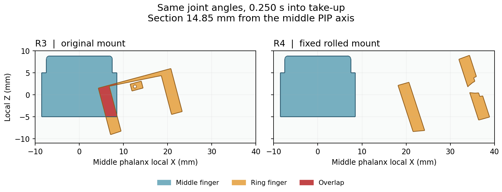

# 15° 三指取球试验 · 让中指与无名指的中节错开

中指的 15° 档、Ø20 mm 球的取球位置和六路驱动沿用上一版。改动集中在无名指与手掌的连接处。两根中节现已沿不同平面弯曲。撤掉球下方的支撑时，三个指腹第一次在开启相邻指碰撞的本轮模型里同时压到球。33 g 球随后在下垂阶段掉落。[上版结构和原始失败记录](recessed-ring.md)

## 原来撞在哪里

从开始收绳算起 0.250 s，在上版允许中指与无名指相互穿过的原因对照轨迹上，SolidWorks 实体布尔运算得到 **364.457 mm³** 的中节相交体。相交体形心在中指中节朝无名指的一侧，沿指节距近侧关节轴 **14.85 mm**，向侧面偏 **6.60 mm**。对应到无名指，是中节朝中指的一侧，沿指节距近侧轴 **19.95 mm**。上版开启碰撞的实际求解里，中指被挡住，撤支撑时对球为 0 N。上图用两件原生零件的三角面生成相同位置的截面；相交体积取自实体运算。[三坐标系定位和局部包围盒](../examples/r4-ring-mount/clash-localization.json)

## 改了什么

- 在掌部实体上保留无名指原有安装面、螺钉孔、螺纹凸台及指根组件。绕平行于手指纵向的导管轴固定翻转 **17°**，指座向小指移 **2.5 mm**、向腕部退 **3 mm**。无名指合拢时向小指侧避让。中指仍锁在 15°，无名指仍由原屈曲腱驱动。
- 在掌座后方连接材料上重新开 **Ø4.4 mm** 导管槽。末端入口随座向侧面移动 2.5 mm，实际软管的弯曲半径与耐磨性有待验证。首次整手重建发现掌座外侧与小指轴端相交 **1.736 mm³**，在这一处加工 **Ø6.4 mm** 局部让位后复查，相交消除。
- 新版指座维护装配含掌部共 **29 件**，重开后重建且未检出静态相交。撤支撑整手快照的 **141 个引用**均已从新版 CAD 目录解析。该姿态仍有两处指腹与球的模型接触穿入和一处食指相邻节约 **0.0000135 mm³** 的微小相交。旧版原件及对照轨迹单独保存。

## 收绳过程的 SolidWorks 检查

把新座放回上版诊断轨迹，保持关节角不变，原相交时刻两根中节之间的净空为 **7.316 mm**。随后用新结构自己的实际收绳轨迹检查。中指—无名指及无名指—小指各检查 **80 个姿态**，均未检出跨指实体相交。前一组最小净空 **0.756 mm**，在中指轴端防脱件和无名指近节之间；后一组最小净空 **0.545 mm**，在无名指根座与小指轴端之间。这两项是采样最小值。[同角度旧轨迹对照](../examples/r4-ring-mount/previous-angles-new-mount.csv)

对指定的两根中节另加 14 个原生距离测点。**94 次原生测量的最小距离为 6.597 mm**。为判断测点之间会不会相交，对每 2 ms 记录的关节角作线性插值。一个间隔内两实体的相对路程，最多为各关节累计转角绝对值乘相应最大半径之和。原生实体包围盒给出的近侧指间关节最大半径分别为 37.55、35.66 mm，计算统一放大至 50 mm。加上 43、39 mm 的近节长度，指根处的半径统一取 100 mm。用区间两端的实测间隙与上述路程界限，得到整段插值回放 **至少 5.712 mm** 的保守净空。这个下界只覆盖这两根刚性中节及指定回放。[原生包围盒](../examples/r4-ring-mount/native-extrema.txt) · [逐区间下界](../examples/r4-ring-mount/R4-mid-bounds.csv) · [复算脚本](../swept_phalanges.py)

两组跨指检查各纳入每指 28 个刚性零件。按原生实体包围盒剔除不可能成为最近对的组合，其余在装配中求最近距离并检查实体相交。柔性腱绳和弹簧未计入跨指实体检查。间隙使用名义尺寸。[中指—无名指原生测量](../examples/r4-ring-mount/R4-middle-cad.csv) · [无名指—小指原生测量](../examples/r4-ring-mount/R4-little-cad.csv)

## 自由球从下垂到水平

取球位置沿用 +5 mm，拇指对掌 32.75°。无名指提前 0.50 s 收绳，由 12 mm 收至 20 mm，中指收绳 28 mm。接触摩擦系数 0.35。球可滚动和滑动，撤支撑后先下垂保持 1 s，随后肘部用 1.2 s 抬至水平并保持 2 s。仿真使用从原生零件生成的刚性凸包以及原有指腹接触模型，开启中指与相邻指、无名指与小指的接触。按新指座位置变换无名指的各轴线、指腹和各节质心，掌部固定结构质量及惯量沿用上版台账。

| 同一取球条件 | R3 原座，标准步长 | R4 新座，0.25 ms | R4 新座，0.125 ms |
| --- | ---: | ---: | ---: |
| 撤支撑瞬间，食指 / 拇指 / 中指法向力（N） | 2.28 / 1.09 / 0.00 | 2.26 / 1.14 / 0.52 | 2.26 / 1.14 / 0.52 |
| 三指均有有效接触的记录点数（每 2 ms 记录） | 0 | 7 | 7 |
| 首次接触下方接球平面 | 球最终停在手部硬件上 | 0.576 s | 0.574 s |
| 通过下垂、抬平并保持验收 | 否 | 否 | 否 |

R4 标准步长下，前 6 ms 三指法向力均大于 0.01 N。**8 ms** 首次记录到中指失去接触，此时球相对手掌已移动 **0.96 mm**。整段记录中有短暂再接触。收绳阶段峰值张力 **14.27 N**，低于本试验 25 N 的张力限值。继续执行肘部动作仅用于观察失败过程；肘部能到水平，球已落下。33 g 工况未通过，150 g 未启动。[标准步长轨迹](../examples/r4-ring-mount/free-33g-base.csv) · [半步长轨迹](../examples/r4-ring-mount/free-33g-half.csv)

另用同一结构筛选了 **27 组**食指、拇指和中指收绳量，观察撤支撑后的前 0.25 s。各组均在前 8 ms 内首次丢失至少一处接触，部分组合还超过 25 N 张力限值。下一次结构试验值得优先考察中指指腹在球滚离方向上的接触位置与法向。[收绳量筛选](../examples/r4-ring-mount/R4-preload-screen.csv)

## 复查

安装 `requirements-free-ball.txt` 后，运行 `python ring_timing.py --r4-mount --observe-lift` 可复现公开的简化接触模型。该模型使用相同的安装变换和收绳输入，省略私有 CAD 硬件凸包，得到触及接球平面 **0.474 s**。上表两次带硬件求解的输入角记录与输出数据在本分支保留。[安装变换代码](../ring_mount.py) · [带硬件的 33 g 求解摘要](../examples/r4-ring-mount/R4-33g-base.json)

Yale OpenHand 的 Model O 展示了改变指根方位以调整包络抓取的设计思路。本项目采用固定安装斜角，在现有六路驱动内验证这个变量；角度、偏移量与干涉判定均来自本项目。SolidWorks 的两实体干涉 API 返回相交体，可把它转入两件零件各自的坐标系定位。[Yale OpenHand Model O](https://www.eng.yale.edu/grablab/openhand/model_o.html) · [SolidWorks API](https://help.solidworks.com/2022/English/api/sldworksapi/SolidWorks.Interop.sldworks~SolidWorks.Interop.sldworks.IModeler~CheckInterferenceBetweenTwoBodies.html)
