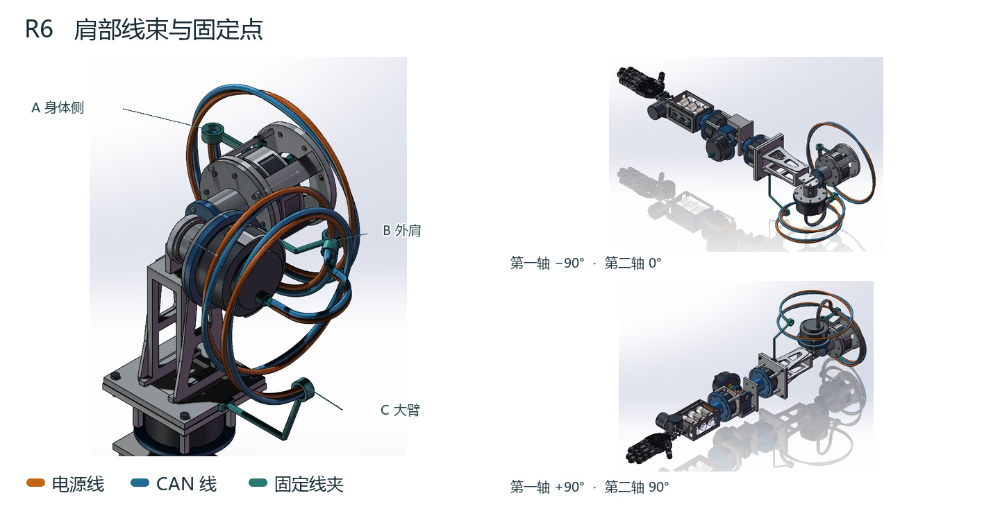

# R6 · 两轴肩关节的线束走向与余量

R6 routes separate power and CAN cables across the two shoulder axes of the [R5 arm](shoulder-r5.md). Three strain-relief stations divide the moving harness into two sections. The orange power cable and blue CAN cable can be inspected separately in the SolidWorks pose assemblies.

## 走线与安装长度

从身体往外，线束先绕贴身法兰轴留一段螺旋形活动线，在外肩叉架上固定一次，再绕外侧正交轴留第二段，最后固定在大臂上。这样转动第二轴时，它所需的线长由第二段提供。沿用第一轴 −90°～+90°、第二轴 0°～90°。电机接线口与固定在同一连杆上的支线单独处理。

| 站位 | 随哪一件运动 | 下垂姿态下的夹孔中心 (X, Y, Z)，mm | 安装方式 |
|---|---|---|---|
| A | 身体侧固定法兰 | (−120, 360, −165) | 使用原法兰 PCD 100 上相邻的两个 M6 孔；支架底板厚 4 mm |
| B | 外侧肩叉架 | (120, 360, −116) | 叉架回折面新增两处 M3 底孔。线夹提供两段活动线之间的应力释放位置 |
| C | 大臂 | (188, 244, 0) | 大臂端框外侧新增两处 M3 底孔。固定点随第二肩轴转动 |

夹孔名义直径 17.3 mm、轴向长度 12 mm。设计束径为 16 mm，包括护套。装配方案为先穿未端接的线束，在线夹内使用可更换的分体弹性衬套，再压接端子。建议衬套自由壁厚 0.8 mm；线夹的实际抗滑力需要用所选衬套和护套确认。B 处把两个活动段的校核端面各退入线夹中心约 1 mm，夹内衔接长度约 2 mm。

| 活动段 | 护套两道校核标线之间的设计长度 | 内部电源线沿自身中心线 | 内部 CAN 线沿自身中心线 |
|---|---:|---:|---:|
| A 至 B | 1,132.1 mm | 1,134.2 mm | 1,134.2 mm |
| B 至 C | 1,186.4 mm | 1,188.3 mm | 1,188.6 mm |

表中是活动标线长度，端子压接、柜内尾线和 B 夹内衔接另计。两根线在每段护套内绕束心约三圈，分别计算自身线长。对每个姿态，求解保持各自长度的平滑排布。每段护套另做共同增减 5 mm 的敏感性检查。这是安装偏差分析，表中小数用于复算。实际装配可用长度工装标记后调夹口位置；不应在线夹外另外堆一圈松线。

电源参考 igus CF9.15.02（2 × 1.5 mm²，外径上限 6.5 mm），CAN 参考 CFROBOT8.022（2 对 × 0.5 mm²，7.0 mm）。按厂家动态弯曲半径要求分别对照 32.5 mm 和 70 mm。这里只按规格核对几何；供电线径定型还取决于同时工作的电机电流、保护和温升。[电源线规格表](https://toolbox.igus.com/wp-content/uploads/2023/08/chainflex-control-cables-catalog.pdf) · [CF9 弯曲条件](https://www.igus.com/product/CF9) · [CAN 规格表](https://toolbox.igus.com/wp-content/uploads/2023/08/robotics-catalog.pdf) · [CAN 弯曲条件](https://www.igus.com/cables/unharnessed-cables-can-bus-cable)

## 装配检查与修订

首轮六个极限姿态暴露出 B 支杆局部穿入外肩叉架（29.23 mm³），并且原先接在同一点的两段束端有小量模型重叠。第二版把支杆贴合处下移，补了安装底孔，调整了夹内分段位置。A、B、C 均随对应连杆运动。[首轮问题对照](../data/shoulder-harness-r6/revision-checks.csv)

- **夹线。** 在伸肘和屈肘 90° 两种条件下，分别检查肩轴单动、两条对角联动轨迹及边界组合。共 70 个不同姿态，Ø16 mm 名义线束、三个线夹与其余机械臂实体均未检出正体积干涉。同一批姿态还以 Ø20 mm 扫掠包络复查，两个包络均未碰到既有机械臂零件；指定夹孔处的预期接触单列。这个额外 2 mm 径向空间只适用于所测姿态的线束与既有机件。[逐姿态 SolidWorks 结果](../data/shoulder-harness-r6/solidworks.csv)
- **拉紧。** 按相同标线长度构造不同姿态下的路径，再测量实际 SolidWorks 三维样条长度。区分“存在无须伸长的路径”和“自由线束实际会采用该路径”。两段名义护套的 CAD 线长偏差均小于 0.001 mm。按 1° 间隔另算共同长度偏差 ±5 mm，模型中的最大束心移动为 1.22 mm。[原生曲线测量](../data/shoulder-harness-r6/native-curves.csv) · [长度偏差](../data/shoulder-harness-r6/length-tolerance.csv)
- **急弯。** 对内部两根线按 1° 间隔求解和检查，最小中心线弯曲半径分别约 81.7 mm 和 81.7 mm。两条不同平面内的活动段在 B 旁相接；对其余非相邻部分按 5° 采样检查，束面间隙的最小采样下界为 10.15 mm。[分线半径与长度](../data/shoulder-harness-r6/internal-lines.csv) · [跨段接近程度](../data/shoulder-harness-r6/cross-loop.csv)

六个端点另以两根独立扫掠实体、两个电机的固定支线和 B 处分线护套重建。均未检出正体积干涉。固定支线单独核算：身体基准面至第一电机插头预留体为 9.1 mm 直段；B 处分线口至第二电机插头预留体为 190.7 mm，两根线分居平行平面，采用相切圆弧和直线。SolidWorks 测得两条固定支线中的最小圆弧半径为 38.81 mm。第二电机和这段支线都固定在同一叉架上；CAN 的固定敷设半径要求为 35 mm。插头使用厂家接口预留体，后端分配和压接尺寸需按安装对象确认。[六姿态分线检查](../data/shoulder-harness-r6/individual-cable-check.csv) · [CAN 固定敷设数据表](https://media.digikey.com/pdf/Data%20Sheets/Igus%20PDFs/CFROBOT8%20Datasheet.pdf) · [电机厂家接线说明](https://www.cubemars.com/product/cables.html)

**下垂后会碰哪里。** 在同样的六个肩部姿态下，保持两端固定位和活动线长度，对每段线的中部另施加 10 mm、25 mm 两种向下偏移，共做 12 次 SolidWorks 检查。10 mm 偏移的六个姿态均无实体干涉。25 mm 偏移时，第一肩轴 +90°、第二肩轴 0° 和 90° 两个姿态均碰到贴身法兰的电机支座。第二轴为 0° 时还碰到分线护套和两根固定支线。其余四个姿态未检出碰撞。两种偏移是人为给定的形状，真实重力下垂量仍待确定，10 mm 也不能当作全行程通用限值。[12 次偏移检查](../data/shoulder-harness-r6/distortion-native.csv) · [具体碰撞零件与体积](../data/shoulder-harness-r6/offset-contact-pairs.csv)

因此这版可以用来评审安装点、线长及风险位置。自由悬挂使用前，优先控制靠身体法兰及 B 分线处的松线，例如试装预成形护套或随动导向，再以同样的两个 +90° 工况复核。现阶段不能确认自由悬挂的线束在整个行程内始终安全。

六个详细姿态各保存为一个原生总装。逐一从 R6 目录重新打开、重建并核对所引用的肩部姿态，每个姿态均解析了 493 个本地零部件实例，干涉计数均为零。[重新打开与重建记录](../data/shoulder-harness-r6/reopened-poses.csv)

## 安装取舍

按两种参考线缆的目录线密度，单是两段活动线的电缆质量就约 0.30 kg，不含护套、接头和支架。这些新增质量尚未计入原肩部电机的扭矩复核。在长度公差筛查中，第一段线束最外缘可达距第一轴约 176 mm，离身体安装基准面最近约 6 mm。后续规划身体轮廓或外壳时，需要留出这部分空间。

上述数据来自 CAD 和规定形状的计算。安装时的真实下垂、线夹抗滑力、摩擦及电缆循环寿命还取决于护套弯扭刚度、布线预形和负载。本轮未进行张力测量或整机寿命试验。[R5 对照](shoulder-r5.md) · [硬件与媒体授权](sources-and-rights.md)
