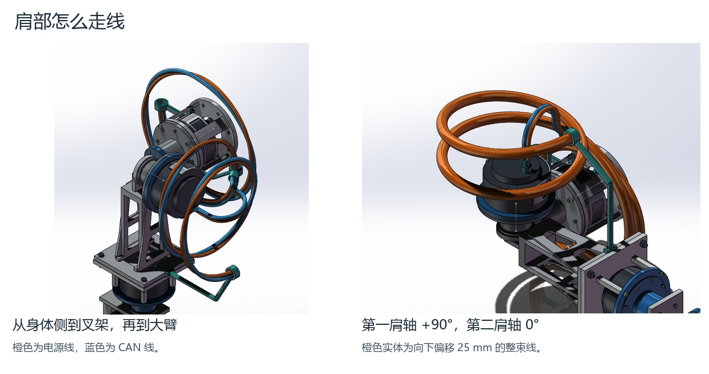

# R7 肩部活动线束与肩轴行程

R7 keeps the R5 shoulder axes and the R6 three-clamp harness architecture. The two 25 mm downward-displacement cases that collided in R6 were reproduced and retested with the same geometry checks. The native SolidWorks model and pose assemblies are archived locally. The measurements below are design and simulation results.

## 为什么分两段

身体法兰、外肩叉架和大臂是三个运动件。A 固定在身体法兰上，B 跟着外肩叉架，C 跟着大臂。A 至 B 的相对运动由第一肩轴决定，B 至 C 的相对运动由第二肩轴决定。中间的 B 夹也给固定电机支线提供分线位置。肩部两个电机仍能独立控制。工业机器人常用分段、活动环和应力释放安排跨轴线缆，本项目采用这一思路。具体位置和线长来自本机的几何计算与复查。[igus 机器人分段布线指南](https://www.igus.com/robot-dress-pack/robot-cable-management-solutions)

选择外绕，是为了用现有法兰、外肩叉架及大臂端框安装，两个肩轴的机械接口可以沿用。目前没有证明这是最短或最紧凑的方案。第一段随第一轴的角度约绕 1.25～1.75 圈，第二段约绕 1.50～1.75 圈。对每个角度，固定两端位置及进出方向，调整环的半径，使中心线弧长等于给定的活动线长。额外的下垂检查将中部沿世界竖直向下偏移，保持两端和线长，再计算路径。真实线束的平衡形态、拉力和寿命还需要材料、夹紧和负载数据。

## 哪些尺寸改变了

| 项目 | R6 | R7 | 选择依据 |
|---|---:|---:|---|
| 身体侧 A 至叉架 B 的活动线长 | 1,132.1 mm | 1,192.1 mm | 增加 60 mm，使线环在紧侧绕开电机支座 |
| 叉架 B 至大臂 C 的活动线长 | 1,186.4 mm | 1,186.4 mm | 增大两端轴向间距，将回绕段与 B 的分线口错开 |
| C 的大臂局部 X 坐标 | 188 mm | 228 mm | 线夹向外移 40 mm，沿用原来两个安装孔 |
| C 支杆直径 | 7.2 mm | 8.6 mm | 支杆变长，增大截面。该修改的受载挠度尚待校核 |

A、B 的位置和分线护套、电机固定支线的走向沿用 R6。C 的夹孔中心在初始姿态为 (228, 244, 0) mm。两段标线总长为 2,378.5 mm，另计端接、固定支线与 B 夹内衔接。第一段电源线与 CAN 线各预留 1,194.10 mm，第二段分别为 1,188.27 mm 和 1,188.77 mm。这些是设计标线长度，小数用于复算。[分线计算](../data/shoulder-harness-r7/individual-lines.csv)

外绕会占空间。第一段在名义路径下的最大径向包络约为 189.6 mm，计入 ±5 mm 长度偏差时为 190.8 mm。R6 在相同长度偏差下约为 176 mm。线束质量、夹具刚度、肩部扭矩和外形收紧需在整机定型时一起复核。[长度与占用空间](../data/shoulder-harness-r7/cut-length.csv)

## 同一工况复现与复测

两次检查均使用 Ø16 mm 整束实体，固定两端、保持设计线长，向下施加 25 mm 的中部偏移，手肘伸直。旧版的两组碰撞同时由 SolidWorks 总装干涉检查及独立的 SolidWorks 实体求交复现。新版八个保存姿态从独立目录重开并重建，其中六个名义姿态单独建模电源线和 CAN 线，两个风险姿态保留向下偏移的整束模型。[旧版复现](../data/shoulder-harness-r7/r6-reproduced.csv) · [新版同工况](../data/shoulder-harness-r7/critical-retests.csv) · [重开总装](../data/shoulder-harness-r7/reopened.csv)

| 第一轴 / 第二轴 | R6 碰撞对数 | R7 碰撞对数 | R7 线束至原问题零件的实测 CAD 距离 |
|---|---:|---:|---|
| +90° / 0° | 4 | 0 | 电机支座 10.35 mm，分线护套 4.29 mm，固定电源线 7.68 mm，固定 CAN 线 9.70 mm |
| +90° / 90° | 1 | 0 | 电机支座 10.35 mm |

距离以重新打开的极限总装中两个零件的最近表面为准。4.29 mm 是对应工况下线束至分线护套的距离，仅针对表中对象。[旧版相交体积与新版间隙逐对对照](../data/shoulder-harness-r7/paired-results.csv) · [各对实体的最近距离](../data/shoulder-harness-r7/critical-clearances.csv)

## 肩部单动与联动

第一轴单独按 −90°～+90°、第二轴单独按 0°～90° 取样；单轴路径每隔 15°，另含对角联动与边界组合。35 个肩角组合分别在肘伸直、肘屈 90° 时检查，全部各做 0 和 25 mm 偏移，六个肩部端点再各做 10 mm，共 152 个工况。每个工况先用 SolidWorks 配合重建并读取实际肩角及肘角，再将各实体按实际刚体变换放置。对两段活动线、改变的大臂夹具及五个固定支线/护套零件与周围实体做原生实体求交，每个工况涉及 486 个实体。先用包围盒排除分离件，再对候选对计算相交体积，152 个工况均未检出正体积相交。此前 4 对及 1 对碰撞用同一算法复现。该检查覆盖给定的采样姿态和偏移形状。[152 个工况](../data/shoulder-harness-r7/motion-cases.csv) · [旧版阳性对照](../data/shoulder-harness-r7/kernel-control.csv) · [原生线长与弯曲半径](../data/shoulder-harness-r7/native-paths.csv) · [六个分线总装](../data/shoulder-harness-r7/individual-assemblies.csv)

两段活动线内的电源线按动态弯曲半径 32.5 mm、CAN 线按 70 mm 检查。名义线形按 1° 间隔计算，另对本轮偏移工况按各自线长求解两根线的位置。数值检查中，活动电源线和 CAN 线的最小弯曲半径分别约为 87.5 mm 和 86.3 mm。两段线之间避开共用线夹邻域后，以两轴 5° 组合和三种偏移量检查，非相邻段间隙的最小采样下界为 8.30 mm。[各工况路径与弯曲半径](../data/shoulder-harness-r7/path-check.csv) · [跨段间隙](../data/shoulder-harness-r7/span-separation.csv) · [R6 线缆规格与原检查](shoulder-harness-r6.md)

这些角度与间隙适用于指定的线形、手肘姿态和采样条件。25 mm 是对照用的设计扰动。实际运行时的惯性甩动、接插件拉力、夹具抗滑力和循环寿命仍需独立校核。

## 后续控制功能

规划为每个关节提供用户可设的最小角与最大角，默认使用设计行程。用户设定只能在机械行程内缩小范围，例如第一肩轴可选 −30°～+45°。手动控制与自动轨迹应共用同一组限制，支持恢复默认值。这项功能留待控制阶段开发。R7 继续使用原有的机械行程。
