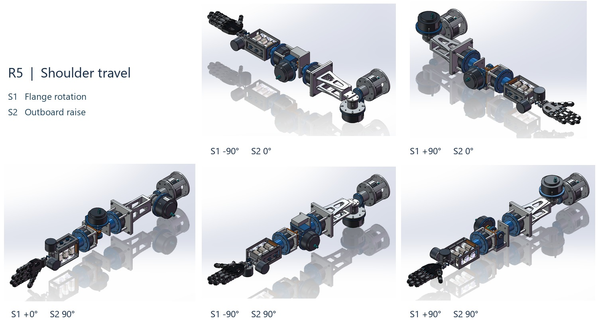

# R5 肩部行程评审 / Shoulder travel study

R5 expands the inboard flange-normal shoulder to −90°…+90° and the perpendicular outboard shoulder to 0°…90°. It uses an independent copy of the seven-axis R4 assembly. The finger drives and downstream joint layout are inherited. [R4 baseline and motion video](full-arm-r4.md)

## 刚体运动

以自然下垂为零。七个关节采用独立的给定角度配合。身体侧圆盘固定，第一轴改变前后抬臂角。第二轴随第一轴一起移动，控制大臂向外抬起。R5 增加肩轴的面板输入范围和五个原生极限配置。原版实体的尺寸沿用 R4。面板在输入目标角后检查该姿态的实体干涉及身体平面净空。

在伸肘 0°、屈肘 90° 两种条件下，其他下游关节保持零位。每种肘姿按 15° 间隔检查 13 × 7 个肩轴组合，共 182 个姿态。另从下垂出发，第一轴分别朝正、负方向运动，第二轴同时侧抬，两条路径均每 10° 取样，各检查 10 次（含端点）。总计 202 次检查，包含重复姿态，全部达到请求角度且未检出正体积实体干涉。

已从 R5 独立目录重新打开原生总装。480 个活动组件实例全部解析到本目录，五个新增极限配置及九个继承姿态均已重建并核对角度。

SolidWorks 数据中角度单位为度。检测考虑零件实体，包含接插件预留体，排除零体积的面接触。请求角与相邻组件实际变换反算的角度分别存列。肩内零件间采用离散采样；其他五轴的任意组合、线束接触和装配公差未纳入这项检查。[逐姿态 SolidWorks 记录](../data/shoulder-r5/solidworks-shoulder.csv)

身体以安装面代表。第一轴绕该面的法线转动，活动件到平面的距离与第一轴角度无关。对每个活动实体局部包围盒的八个角，求第二轴全行程内相对平面距离的极小值。对伸肘和屈肘 90°、其余轴为零的两种设定，整个目标角域的保守净空下界均为 80.58 mm。该值描述活动件到理想身体平面的距离。[极值与限制部件](../data/shoulder-r5/plane-envelope.csv)

## 肩部线束目前能判定什么

肩电机接插件在 CAD 中有预留体。归档没有给出跨肩电源线、信号线的安装长度、动态线径和弯曲半径，也没有定义线夹和实际走向。以下用两段候选位置评估几何跨度，坐标为整臂下垂时的装配坐标，单位 mm。

| 站位 | 坐标 | 依据 |
|---|---|---|
| A，身体侧 | (0, 382, −179) | 假设从身体安装法兰中心孔内、偏心 22 mm 处出线 |
| B，随第一轴转动 | (140.9, 338, 0) | 外肩接插件预留体朝 +X 端面的中心，作为第二段上游参考 |
| C，随大臂转动 | (55, 148.6, 55) | 取上臂外侧已有 M6 螺母包围盒中心，表示待设计线夹的大致位置 |

| 跨段 | 下垂时直线距离 | 整个肩角域的最大直线距离 | 相对下垂姿态的最大增加 |
|---|---:|---:|---:|
| A–B，跨第一轴 | 232.0 mm | 243.2 mm（第一轴 −81.1°） | 11.2 mm |
| B–C，跨第二轴 | 215.1 mm | 240.8 mm（第二轴 90°） | 25.7 mm |

这里计算的是端点之间的直线距离。对每段，距离平方可写成常数加上旋转角的正弦项和余弦项；比较两端和区间内驻点得到最大值。线束必须绕开壳体并留出弯曲、扭转和应力释放空间。现有输入只够给出上述候选位置的跨度下限，**线束余量是否足够仍待验证**。定型需选线缆和线夹、给出两夹间自由长度，然后在全行程检查弯曲半径、拉紧与夹线。此检查方式参考了 igus 对机器人线束服务环和应力释放的安装说明。[计算脚本](../data/shoulder-r5/cable_reach.py) · [5° 间隔结果](../data/shoulder-r5/cable-chords.csv) · [igus 机器人线束安装说明](https://www.igus.com/contentData/wpck/pdf/us_en/Triflex%20Retraction%20System%20Assembly%20Guide.pdf)

本轮为 CAD 运动评审。原生装配保存在私有工程归档。[公开材料与硬件授权](sources-and-rights.md)
