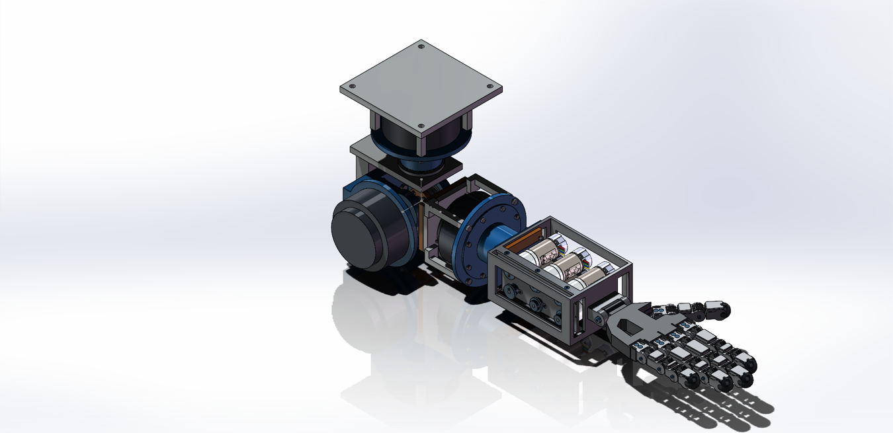
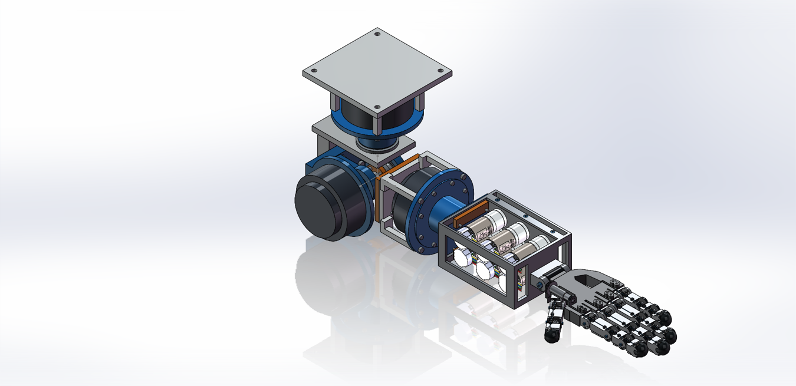

# 机器人上臂安装用三轴肘部

选定上置同心布局。左右摆单元固定在机器人上臂一侧，摆轴与抬臂轴交于肘中心。前臂左右摆动时，肘中心保持原位；翻掌单元沿前臂长轴带动机械手、锁定腕部和六路手指驱动一起旋转。对接具体机器人时，需要按其上臂法兰孔位、安装空间和线束出口设计转接件。

| 水平、掌心朝下 | 水平、掌心朝上 |
| --- | --- |
|  |  |

## 运动范围与校核

本轮 CAD 展示范围为下垂到抬平 0°～90°、左右摆各 40°、翻掌 0°～180°。完全下垂时左右摆轴和翻掌轴共线，演示先抬臂再分别做这两个动作。上置版六个已保存配置和六个中间采样姿态均未检出实体干涉。[原生配置测点](../data/three-axis/center/poses.csv) · [逐姿态干涉采样记录](../data/three-axis/center/interference-samples.csv)

空手水平保持的计算力矩约为 4.43 N·m。在手端额外施加 150 g 结构载荷后，抬平保持需要约 5.18 N·m，上臂侧摆轴支撑需承受约 4.97 N·m 的倾覆力矩。末端载荷能力与抓球接触稳定性分别验证。[上置版载荷计算结果](../data/three-axis/center/loads.json) · [载荷计算脚本](../three_axis_loads.py)

位姿脚本默认使用上置布局，可运行 `python three_axis_pose.py --yaw 40 --lift 90 --roll 180` 查看肘中心和中指指腹位置。[位姿计算](../three_axis_pose.py) · [早期布局比较与紧固件修改记录](three-axis-layout-study.md)
