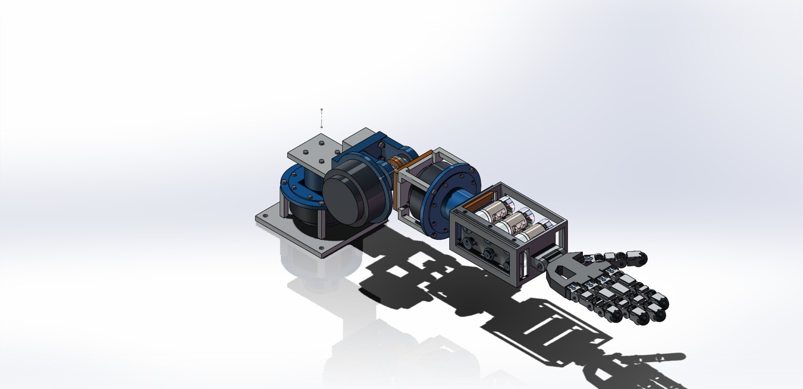
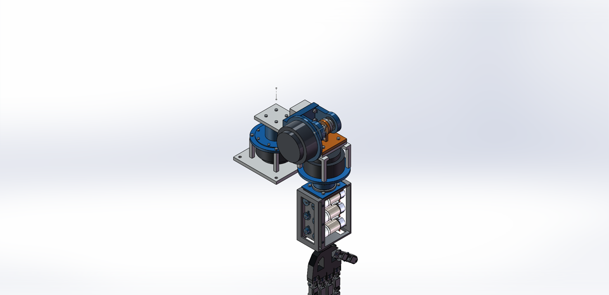
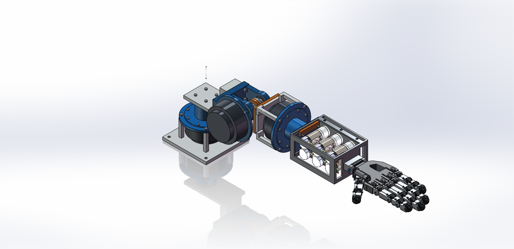
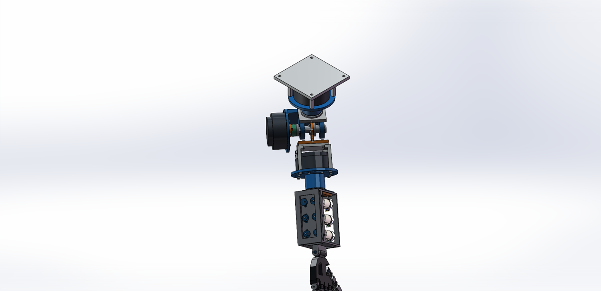

# 三轴肘部 R3 · Yaw, pitch and forearm roll

固定上臂，前臂可以从下垂抬平、向左或向右转向，以及保持肘角把掌心翻转 180°。六台手指驱动器跟着前臂一起转。原有 R2 单轴装配与三指掉球对照各自保留。下图取自三轴 SolidWorks 总装。

| 前臂下垂 | 前臂水平、掌心朝上 |
| --- | --- |
|  |  |

## 三条轴与载荷路径

**两种安装布局。** 顶部照片采用底置转台，摆轴在原肘轴中心后方 145 mm，摆动 40° 时原肘轴中心沿弦移动约 99.2 mm。要让肘中心固定，可选上置同心布局：竖直摆轴和横向抬臂轴交于原肘中心，前臂下垂时下方留空。两版使用同一套前臂侧组件。完全下垂时，上置同心版的摆轴和翻掌轴共线，两个角度输入对末端瞬时方向的作用重合；复合动作先略微抬臂即可离开该姿态。[同心版原生配置测点](../data/three-axis/center/poses.csv)

| 上置同心版，肘中心固定 | 同一装配，三轴组合姿态 |
| --- | --- |
|  |  |

| 轴 | 结构与功能 | 本轮展示范围 |
| --- | --- | --- |
| 左右摆 | 固定底座上的竖直转轴带动整个肘架，决定前臂朝哪一侧抬起 | 相对正前方 ±40° |
| 抬臂 | 沿用 R2 的横向主轴、双侧支架及驱动接口 | 下垂至水平，0°～90° |
| 翻掌 | 肘部输出桥架承托纵向驱动单元，旋转法兰、端板和背夹条将扭矩传给整个原前臂 | 掌心朝下至朝上，0°～180° |

两个新增轴各设置一台 AK70-10 简化驱动模型及两只 6002-2Z 外支撑轴承。方榫传扭，主轴中心螺钉从输出侧装入。载荷经前臂端板、翻掌轴承座、抬臂主轴与肘架，再经底座轴承返回固定侧。选择同型号便于沿用已登记的接口，代价是翻掌单元较重。当前三轴总装使用原五指手张开配置，手指腱绳均随前臂转动。

## 结构修改及复核

首轮实体检测发现四颗 M5 螺钉头与肘架、四颗端框夹紧螺钉头与输出法兰重叠。分别给肘架加工头部避让，并将输出法兰外径从 58 mm 收至 53 mm。随后把主轴锁紧改成输出端可拆的轴心螺钉，以便先安装电机联轴件再插入主轴。

最终总装关闭、重新打开后，六个已保存配置逐个重建并读取刚体变换。每个配置解析 354 个活动组件实例，引用均指向 R3 本地目录，顶层配合错误数为零。另沿组合运动取六个中间姿态，十二个采样姿态均未检出实体重叠。检测包含嵌套零件，重合接触面不计入干涉。样本以外的姿态、线束弯曲和工具空间仍需验证。轴范围是本轮在装配中使用的范围。[配置与手端坐标](../data/three-axis/poses.csv) · [底置版采样检测](../data/three-axis/interference-samples.csv) · [同心版采样检测](../data/three-axis/center/interference-samples.csv)

## 抬平需要多少力矩

翻掌单元使原前臂整体向前移 116 mm，水平时肘轴至指定中指指腹测点的轴向距离从 395.2 mm 增至 511.2 mm。抬臂轴的空手运动质量约 **2.86 kg**，空手水平保持力矩从 R2 的 **1.81 N·m** 增至 **4.43 N·m**。测点附加 **150 g** 静载时从 **2.39** 增至 **5.18 N·m**。分组质量来自 CAD 实体体积、假定材料密度和厂家整机质量替换；六台手部电机各按 104 g 计一次，三台关节驱动器各按 621 g 计一次。重心及转动惯量沿用包络近似。

| 底置版，150 g 附加载荷下的分轴运动 | 单独运动用时 | 输出峰值转速 | 理想刚体输出峰值 | 乘 1.5 设计系数 |
| --- | ---: | ---: | ---: | ---: |
| 水平转向 80° | 2.4 s | 10.42 rpm | 0.54 N·m | 0.82 N·m |
| 下垂到水平 90° | 1.2 s | 23.44 rpm | 5.18 N·m | 7.77 N·m |
| 水平时翻掌 180° | 2.4 s | 23.44 rpm | 约 0.015 N·m | 约 0.022 N·m |

每次计算只运动一根轴，另外两轴保持在水平参考装配对应的角度。采用五次多项式、每段 2,401 个时间样本，计算重力矩和转动惯量乘角加速度，保留实际符号后取绝对值最大值。翻掌轴的小数值来自重心接近轴线的理想刚体模型，实际选型还需计入摩擦、线束扭转、电机转子折算惯量及偏载。三轴同步快速动作需要多体动力学复核。[可运行计算](../three_axis_loads.py) · [分组质量与惯量](../data/three-axis/rigid-groups.json) · [逐轴结果](../data/three-axis/loads.json)

AK70-10 厂家额定输出为 8.3 N·m，高于上述 7.77 N·m 抬臂设计值。指标与零速长时间保持的允许温升要分别核对。底置版水平带载时，左右摆轴虽无需以电机扭矩抵抗重力，固定侧仍要承受约 **10.9 N·m** 倾覆力矩。按新增轴承中心距 16 mm 将该力矩换算成理想径向力偶，每只轴承约 0.68 kN，另有约 44 N 的竖向载荷；两轴承与电机内部支撑的实际分配取决于对中、预紧和各支撑柔度。R2 支架曾做过的有限元应力和手端下沉结果适用原工况。R3 的支架变形、布线、限位及热保持尚未定型。[CubeMars 额定数据](https://www.cubemars.com/product/ak70-10-kv100-robotic-actuator.html) · [SKF 6002-2Z](https://www.skf.com/group/products/rolling-bearings/ball-bearings/deep-groove-ball-bearings/productid-6002-2Z)

上置同心版水平带载时，摆轴支撑的倾覆力矩为 **4.97 N·m**，同样 80° 转向轨迹的理想输出峰值为 **0.217 N·m**。两种安装布局的抬臂、翻掌运动件相同。底座位置的改变直接影响摆轴所承受的弯矩和绕竖直轴的转动惯量。[同心版载荷复算](../data/three-axis/center/loads.json)

运行 `python three_axis_loads.py` 可复算两种布局及载荷。运行 `python three_axis_pose.py --yaw 40 --lift 90 --roll 180` 可获得上置同心版的肘中心与中指指腹坐标，添加 `--offset` 切换到底置版。原生 SolidWorks 及 STEP 保存在本地技术归档；公开资料提供真实 CAD 截图、姿态实测值、修改前后采样检测结果和分组力学数据。150 g 是结构等效载荷，抓取能力以三指实验分支独立的自由球测试为准。[三指抓取记录](https://github.com/pyuyan0057-jpg/robot-elbow-portfolio/tree/experiment/tripod-mcp)
