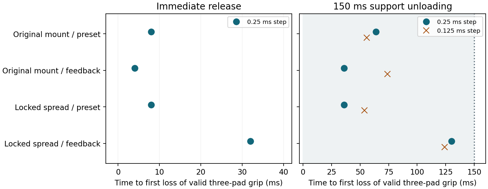

# 同一取球位置下，拇指横摆与三指协同能否留住 33 g 球？

**四组均在起抬前掉球。** 横摆与反馈组合在本轮延长了三指连续接触时间。把 −4° 横摆设置成取球前锁定的第二轴后，组合方案在瞬时撤支撑时首次失去有效夹持的时间从基线的 8 ms 延至 32 ms。采用 150 ms 渐进卸载时，组合方案维持到 130 ms，半步长复算为 124 ms。此时外部支撑仍未撤完。[四组完整结果](../examples/coordination/factorial-33g.csv)

## 试验如何分组

使用 R4 原有六路驱动和私有 CAD 碰撞凸包。中指 15°、拇指原对掌 32.75°、取球位置 +5 mm、球径 20 mm、指腹滑动摩擦系数 0.35。所有组共用掌坐标系球心（−36.944，−20.058，−57.347）mm。原始掉球记录仍在分支上；新程序单独复跑瞬时撤支撑基线，2,101 个采样点的硬件接触名称一致，重现了 8 ms 中指脱离、576 ms 触地。[保留的 R4 结果](rolled-ring-mount.md) · [逐列复现误差](../examples/coordination/baseline-replay.json)

- **结构变量**为拇指根部的第二根理想锁定轴。绕穿过拇指近侧屈曲关节中心、平行于手掌 Z 的直线预调。在摆角模型里一同变换指节轴线、质心、凹面指腹和随指座运动的硬件。原对掌转子保持原角度。抓取过程中横摆角恒定，全程没有新增致动输入。
- **控制变量**为食指、拇指、中指三根原有屈曲腱的卷收指令。反馈组在开始撤支撑前 300 ms 接管，按 500 Hz 采样指腹法向力，以一阶滤波平滑。各指的收绳速度由自己的目标力误差和相对三指平均误差的差值共同决定。主要对照使用食指 **1.0 N**、拇指 **1.2 N**、中指 **1.7 N** 的目标。附加行程限 ±3 mm、调整速度限 8 mm/s、接近 24 N 时减速放绳，这些是仿真假设。指腹反馈来自求解器，尚未建立实物传感器及驱动带宽模型。[控制器与横摆变换](../tripod_coordination.py)
- **支撑变量**另做对照。在每种卸载方式内部仅改变结构和控制。瞬时撤除沿用 R4；渐进卸载记录解除球位姿约束前的六分量反力和反力矩，解除约束后，在 150 ms 内把该外力与力矩线性降为零。灰色区间内的接触不计入独立持球时间。此卸载是数值上的载荷交接。
- **选参和验收**。先比较 9 个横摆角（0°、±2°、±4°、±8°、±12°）和 5 种控制配置共 45 组，均从同一初始位置闭合。在完全撤除支撑后的 220 ms 内，45 组均未记录到三指独立、无硬件承托的有效夹持。取卸载期间连续有效时间最长的 −4° 与偏重中指的目标作为主对照，所有主对照使用同一角度或反馈参数。每组执行完全撤支撑后下垂 1 s、抬臂 1.2 s、水平保持 2 s。[45 组短程筛选](../examples/coordination/screen.csv)

有效夹持要求每次 2 ms 记录中三个目标指腹法向力均超过 0.01 N，无名指接触力不超过 0.001 N，硬件及接球平面不承托球。整个求解每个积分步检查腱张力峰值是否超过 25 N。下垂和水平保持末 0.25 s 还要求肘角误差小于 1°、球相对掌的线速度小于 2 mm/s、角速度小于 0.2 rad/s。

## 实际求解

下表从**开始卸载**计时。渐进卸载列中的两数依次为 0.25 / 0.125 ms 积分步长。瞬时撤除对照采用 0.25 ms。各组峰值腱张力约 14.27 N。

| 预调拇指角 / 输入 | 瞬时撤除后首次失效 | 渐进卸载时首次失效 | 渐进卸载时球触地 | 33 g 全程 |
| --- | ---: | ---: | ---: | --- |
| 0° / 预设收绳 | 8 ms | 64 / 56 ms | 544 / 542 ms | 失败 |
| 0° / 三指反馈 | 4 ms | 36 / 74 ms | 608 / 614 ms | 失败 |
| −4° / 预设收绳 | 8 ms | 36 / 54 ms | 540 / 532 ms | 失败 |
| −4° / 三指反馈 | **32 ms** | **130 / 124 ms** | 630 / 628 ms | 失败 |

组合方案在渐进卸载中先失去拇指接触。标准步长下同时出现约 0.52 N 的球与硬件接触。其余两项单独改动未表现出一致的收益，原角度加反馈的首次失效时刻对积分步长敏感。模拟继续执行肘部指令以观察后果，所有组的球都在起抬前触地。[完整时间序列，GZIP 压缩 CSV](../examples/coordination/full-traces.csv.gz)

## 失败来自哪里

在四组开始卸载的瞬间，从求解器提取指腹与球的接触位置和法向，用力与力矩六个平衡方程做静态检查。允许各接触法向力自由分配时，四组都能在摩擦锥的内接 32 边形内找到支承重力的解。把各接触点的法向力固定为仿真实际值后，即便放宽到外切摩擦锥，四组也都找不到静态平衡。这个结论针对单一姿态；判定中允许独立分配各点力，实际腱驱系统未必能实现这些力。[接触坐标、压力与可行性](../examples/coordination/contact-wrench.json) · [静力求解器](../tripod_wrench.py)

又用较保守的摩擦系数 0.28 和三档最小预紧力计算目标，再以实际接触摩擦系数 0.35 进入动态反馈试验。两种拇指角共 6 组，同样均未在完全撤支撑后的观察期获得有效三指夹持。按各指合计法向力控制，不能保证力在凹面各接触点的分布，也不能保证接触位置在球滚动后保持。[平衡力目标筛选](../examples/coordination/equilibrium-screen.csv) · [目标生成代码](../tripod_preload.py)

本轮保留六路驱动与 R4 原生 CAD。−4° 的收益止于短暂接触，尚不足以定型横摆座；150 g 工况未启动。后续能区分控制问题与结构问题的一项验证，是在完全撤支撑前检查球上剩余的合力与合力矩，再检验现有三根屈曲腱能否消除它们。

安装 `requirements-free-ball.txt` 后，可用 `python tripod_factorial.py --angle -4 --profile middle` 运行公开的简化接触模型。上表来自含私有硬件凸包的计算。拇指横摆的设想参考了改变指根方位以适应抓取构型的做法，反馈则借鉴逐指测量接触状态的思路；本轮控制器使用法向力，没有实现文献中的滑移预测器。[Yale Model O](https://www.eng.yale.edu/grablab/openhand/model_o.html) · [多指触觉反馈研究](https://dspace.mit.edu/entities/publication/cacdfdfa-abcd-4bb5-9017-e6cf22f7fb93)
