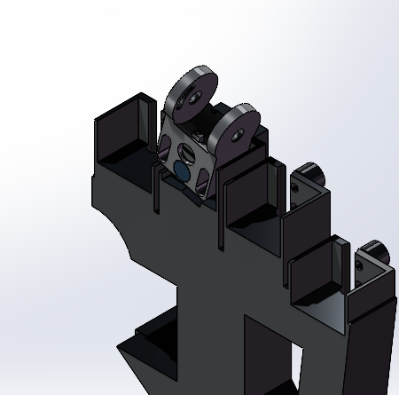
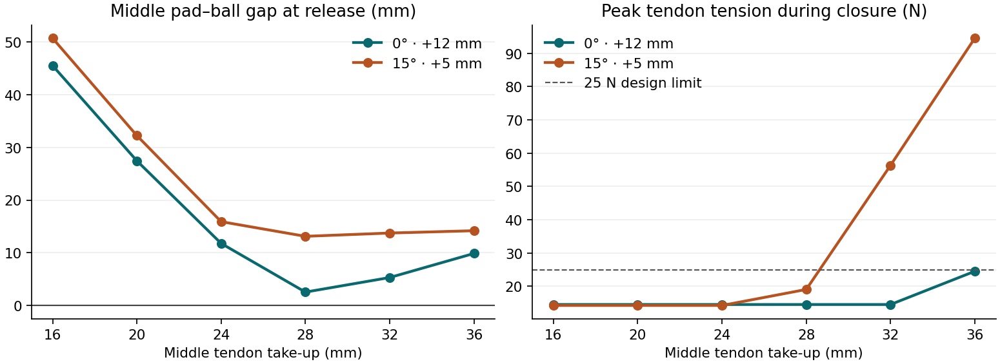

# 中指两档定位与 33 g 三指抓取试验

Ø20 mm 球在两种取球位置都未形成稳定三指夹持。侧摆 15° 时拇指与食指同时接触球，但中指没有在撤支撑时接住它。下表采用同一中指收绳量 28 mm 和带 CAD 硬件外形的模型。

| 中指档位、球心沿掌部 +X 位移 | 食指法向力 | 拇指法向力 | 中指法向力 | 中指指腹到球面的间隙 | 下垂 1 s 结果 |
|---|---:|---:|---:|---:|---|
| 0°、+12 mm | 2.233 N | 0 N | 0 N | 2.54 mm | 未通过 |
| 15°、+5 mm | 2.276 N | 1.088 N | 0 N | 13.13 mm | 未通过 |

### 指根如何调节

沿用原中指屈曲轴与腱驱动，修改掌部座面与中指叉架。调档时卸下原 M3 压紧螺钉和新阶梯定位螺钉，将叉架换装到另一组孔，检查导套和衬管落槽后重新锁紧。近孔用 Ø1.99 mm 定位段配 Ø2.03 mm 座孔，以 M2 螺纹固定，远孔由 M3 螺钉夹紧。两孔到中指根中心的半径为 11 和 17 mm。掌部设两档绳路避让槽，叉架切去与邻指根及轴端螺钉冲突的局部。侧摆仅在调档时改变，工作时仍是原来的六路驱动。在本装配坐标系，第二档绕掌面法向为 −15°。

从独立工程目录用 SolidWorks 2023 重新打开并强制重建，两个指根装配各解析 5 个本地组件，两档固定位置均检出 0 处实体干涉。整手撤支撑姿态各解析 141 个组件。两档均有食指指腹与球的接触穿入，以及食指相邻两节约 0.00001 mm³ 的微小穿入。0° 整手另有拇指末节与球约 0.00051 mm³ 的穿入。整手文件用于检查这一时刻的几何；活动绳和弹簧由求解模型描述。绳路全程、锁紧件承载和装配公差仍需单独校核。

### 从下垂姿态撤掉取球支撑

仿真保留浅凹拇指、32.75° 对掌及食指和拇指原收绳输入。15° 档下，全伸中指侵入张开的无名指空间。两组统一采用无名指预收绳 20 mm 的无载平衡姿态（65.0°、42.1°、32.7°），试验中将无名指保持在该姿态。无名指就位过程与接触后的柔顺退让尚未建模。拇指、食指和中指从展开开始，用 0.50 s 收绳，在临时支撑上静置 0.35 s，再撤去支撑。球可以自由平移、旋转。指腹摩擦系数假设为 0.35；中指三节等效弹簧刚度为 7.05、10.00、12.02 N·mm/rad。模型使用原整臂惯量台账，在下垂试验中忽略局部机加工的质量差。

每档比较 16、20、24、28、32、36 mm 六个收绳输入。MuJoCo 积分步长 0.25 ms，每 2 ms 记录一次；28 mm 工况以 0.125 ms 重算，并与公开可运行的指腹简化模型对照。研究工况含 136 个注册的硬件凸包和分区凹面；更新掌座、叉架和定位螺钉来自修改后的 CAD。凸包可能填平零件凹槽，接触力读数用于比较和定位冲突。绳路传动采用力臂与弹簧模型，未求解导套摩擦、磨损和绳体碰撞。

通过条件要求撤支撑后的各采样点三指法向力都超过 0.01 N，球无硬件或接球平面支撑，腱张力不超过 25 N（含准备阶段的采样值）。稳定段最后 0.25 s 内，球相对掌部线速度小于 2 mm/s、角速度小于 0.2 rad/s，肘角误差小于 1°。33 g 下垂保持通过后才启动 1.2 s 抬平与 2 s 水平保持；33 g 全程通过后才进入 150 g。

12 组带硬件凸包的标称试验，撤支撑后均无一个采样点形成三指同时接触。两组 28 mm 工况在 1 s 时指腹支撑都已消失，球分别受到约 1.18 N、0.65 N 的硬件法向力。仅看球有没有落到地面会误判。将步长减半，两组仍未通过。15° 档把收绳增加至 32 mm 时，收绳阶段最大腱张力升至 56.3 N，已超过本轮 25 N 限值。33 g 抬升和 150 g 试验均未启动。[全工况结果](../examples/tripod-cases.csv) · [28 mm 两档逐时刻序列](../examples/tripod-trajectory.csv)

### 找出下一处要改的结构

15° 档 28 mm 时，中指三节实际约为 39.8°、69.2°、70.0°。[独立关节几何扫描](tripod-mcp.md)中接近球面的一组角度为 64°、74°、42°。真实腱驱动使末节先到上限，指根屈曲不足。最大邻指接触发生在**中指中节与无名指近节**。0° 档中指离球更近，但拇指在撤支撑时失去接触。

再取 15° 档，按目标角和 1、2、4 N 三种设计腱张力反算三节弹簧刚度，各试标称收绳及增加 1.5 mm 两种输入。反算使用无载平衡 `kᵢ qᵢ = T · dL/dqᵢ − 0.002 N·m`，SI 单位；动力学中重新计入重力与接触。六组均未在撤支撑时形成中指接触。优先检查中指中节与无名指近节之间的运动净空，以及无名指的避让时序，再决定是否调整中指力臂。[刚度试算的输入与结果](../examples/tripod-spring-check.csv)

### 复现简化模型

安装 `requirements-free-ball.txt`，运行 `python tripod_trial.py straight --stroke-mm 28` 和 `python tripod_trial.py indexed --stroke-mm 28`。脚本打印判定，并将每 2 ms 的记录写入 `outputs/tripod/`。公开版保留自由球、凹形拇指、三条屈曲腱与三处指腹接触；带硬件凸包的数值另见结果表中 `cad_hulls=True` 行。原生 CAD 与硬件网格按本项目的归档和发布范围保存在本地。[项目发布范围](sources-and-rights.md)
