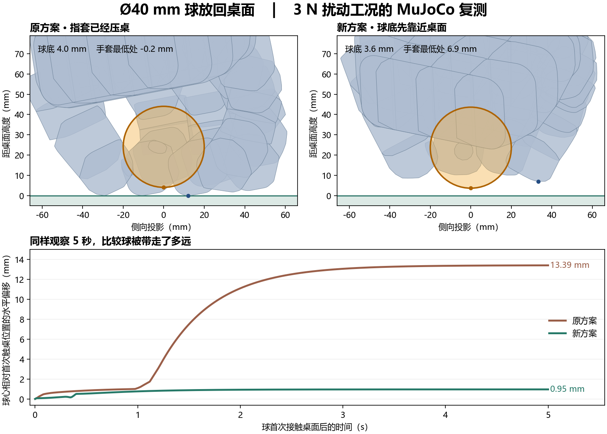

# 七轴仿生手臂 · 把球放回桌面

对佩戴分段指套的同一只手、同一张水平桌和同一颗 Ø40 mm、33 g 的自由球，修改了下降、卸载和撤手控制。MuJoCo 3.3.7 中，原 3 N 向下扰动工况实现了球先落桌、手指随后松开。球首次触桌 5 秒后的水平移动由 13.39 mm 降至 0.95 mm，相对目标点的误差由 5.07 mm 降至 1.70 mm。



## 原先哪里出了问题

原 C7 能把球抬起并保持。在下降过程中，食指末节指套先碰桌；以 2 ms 间隔记录、接触法向力首次超过 0.03 N 为准，手套在 5.812 s 先触桌，球在 7.000 s 才触桌。球最后落在目标附近，但从首次触桌到离手后又移了一段距离。仅看最后球离目标多远，会漏掉这段移动。

C7 归档结束时的目标误差是 3.91 mm，当时球还在滚动。为公平比较，将原动作末尾静止观察延长 5 秒。复跑和原档重合时段的全部 44 列运动与接触输出已逐点对齐，绝对差限为 1e−9。下表统一取首次触桌之后第 5 秒。

| 3 N 原工况 | C7 | C8 |
|---|---:|---:|
| 首次触桌的是 | 食指指套 | 球 |
| 从首次触桌到第 5 秒的球心水平移动 | 13.39 mm | 0.95 mm |
| 第 5 秒时球心与目标的水平距离 | 5.07 mm | 1.70 mm |
| 下降开始至结束的手与桌面峰值接触力，2 ms 记录 | 2.68 N | 0.00 N |

## 具体改动

1. 沿用原抓取、45° 到 100° 抬臂以及高位握持。3 N 对照的下降开始前，已核对两版采样球心位置及拇指、食指腱力一致。抓取目标和摩擦参数沿用原值。
2. 下降时先转动手腕、在桌面上方调整各指的腱绳行程和拇指对掌角，让球从手套下方露出来。在距桌 15 mm 内，以 2 ms 间隔比较球底和整只手所有指套、掌套碰撞网格的最低点，3 N 工况最小高度差为 3.30 mm。图中的轮廓取自求解状态的几何投影。
3. 球触桌后，控制器根据 MuJoCo 的球桌法向力确认支撑，必要时继续缓慢下移，允许的追加位移约 2 mm。释放要求检测到至少 0.16 N 的持续支撑，并经过接触等待。在这次运行中，球在 9.008 s 触桌，9.238 s 启动松手。松手后桌面的最低支撑力为 0.152 N，结尾桌面承担约 0.324 N 的整球重量。
4. 手指错开松绳，拇指比最早松开的手指晚 224 ms，手腕同时做小幅水平补偿并上撤。先试的版本已经做到球先触桌，但触桌后球仍移动约 7 mm。这促使我们同时调撤手方向和松指时序。

在线承载判断使用了仿真器提供的球桌接触力和手球接触载荷。实际手上已有的两处虚拟指腹触觉用于抓持补偿；若要在没有测力桌的实物上复现放置控制，需要另外实现并验证桌面承重估计。相机、真实软手套变形和实物试验均未纳入本次结果。

## 验收与范围

冻结参数后，重新从静止桌面开始跑 C7 原有的 14 组对照，每个工况保留自己的外力方向、脉冲时刻、初始偏移与噪声种子。C7 原先通过完整抓放的 7 组，C8 全部满足新的放置要求。这 7 组的最终目标误差为 0.54～1.57 mm，触桌至结束的最大水平偏移均小于 2 mm。其余 7 组仍未通过完整任务，其中 6 组出现失持，另 1 组的高位保持稳定性超限。单独调松手不能补救先前的掉球。

本次工程验收采用原有的桌面取球、高位保持、持续抓持、放回及释放条件，并额外要求下降中球先接触、手桌峰值小于 0.03 N、球底在最后 15 mm 下降采样中低于手套、松手后持续有桌面支撑、最终误差及触桌后最大水平偏移各不超过 2 mm。两项 2 mm 为本次设计目标。3 N 工况将物理步长从 0.25 ms 减半，保持控制周期为 2 ms，仍全部通过。较细步长的目标误差为 0.48 mm，表明亚毫米数值对离散步长敏感。

## 复跑与文件

从仓库根目录，使用 C4 的 Python 3.11 环境、MuJoCo 3.3.7 和项目原生动力学库。

```powershell
python studies/seven-axis-ball-c7/study.py --build --cases push_y3 --modes window6
python studies/ball-placement-c8/verify.py --all
python studies/ball-placement-c8/baseline.py
python studies/ball-placement-c8/report.py
```

- [冻结的动作参数](frozen.json)
- [14 组、参考工况与减半步长的逐组结果](evidence/verification.json)
- [同一观察窗口的对照数据](evidence/matched.json)
- 实际关节状态、球心轨迹及接触载荷保存在本工作副本根目录的 `outputs/ball-c8/`。参考新版为 `push_y3_final.npz`，原版延长观察记录为 `c7_extended.npz`。两者均为自由接触物理求解。

设计时参考了研究者将物体朝向调整和接触反馈用于精确放置的做法。本项目对球单独测量首次触桌后的滚动，并将仿真接触力的来源写入控制假设。[Placing by Touching，作者项目页](https://niklasfunk.com/publication/stable-tactile-placing/)
