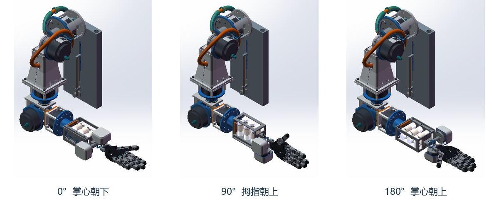

# R8.8 · Right forearm rotation / 右前臂翻掌

### 这一版改了什么

R8.8 从 R8.4 无外壳整臂建立副本。原先掌心朝下和朝上的两个端点都能到位，但右手从一个端点转到另一个端点时，拇指经过下方。此次调整前臂翻转轴 `F1_ForearmRoll` 角度配合的旋转方向。屈肘 90°、指尖朝前时，右手现在经过“掌心朝下 → 拇指朝上、掌心朝身体内侧 → 掌心朝上”。肘屈伸沿用 0°～105°，手指保持张开。

| 观察项目 | SolidWorks 结果 |
|---|---|
| 中间的握手姿态 | 翻掌指令为 90° 时，拇指指腹质心比小指指腹质心高 125.53 mm。 |
| 去程和回程 | 0°→180°→0°，每 10° 取样。往返各 19 次，共 38 次检查，均未检出正体积实体相交；其余六轴保持设定角度。 |
| 保存后重开 | 三个展示配置均重新打开并复核，519 个组件实例均从副本目录解析。 |

上述结果适用于这个肘腕姿态下的裸手刚体装配。跨翻掌轴电线的动态扭转余量、戴手套运动和实物性能仍待验证。[逐角度原始记录](pose-checks.csv)

### What changed and how to read the data

The starting point was the bare R8.4 arm. Its palm-down and palm-up endpoints looked correct, but the right thumb passed underneath during the transition. Reversing the forearm roll mate makes the thumb pass above the little finger at mid-travel. The elbow stays at 90°, the wrist is neutral and the fingers remain open throughout this check.

In the [SolidWorks export](pose-checks.csv), filter `phase` to `sweep` for the 38 outbound and return samples. `config` identifies the three saved poses and `reopen` the three checks after reopening. `roll_signed` is derived from component transforms and may read −180° at the +180° endpoint. `thumb_above_little_mm` measures the vertical separation between pad centres. All sweep rows report zero positive-volume interference regions. Cable torsion and motion with a glove have yet to be verified.

[Previous public milestone · R8.4 shoulder cable return](../shoulder-return-r84/README.md) · [CAD access and hardware permissions](../../docs/sources-and-rights.md)
