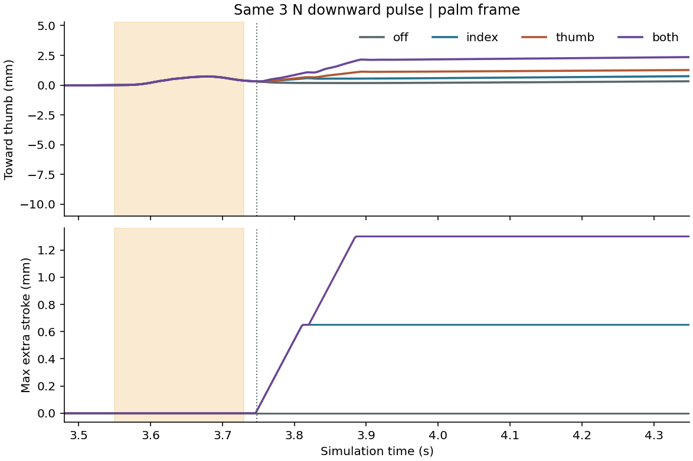

# C7 · 小球为什么被两指补偿推偏

对象为原 Ø40 mm、33 g 自由小球，七轴抬臂和六路手驱动沿用 C6。实验只改变食指和拇指的附加收绳。所有结果均为 MuJoCo 仿真。本地研究分支 study/c7-ball-tendon-timing 保留 C6 对照。

## 1. 用相同扰动追查原因

原工况在高位保持时施加世界 +Y 向下的平滑脉冲，峰值 3 N，起止时刻为 3.550～3.730 s。六次对照共用同一起始姿态、控制周期、接触参数和传感器噪声。前四次实时运行同一检测器。后两次固定重放原两指方案的两次触发，以分离手指作用与报警次数的影响。

| 额外收绳方案 | 实际动作时刻 (s) | 保持段移动幅度 (mm) | 保持结束前相对无补偿向拇指侧多偏 (mm) |
|---|---|---:|---:|
| 无 | — | 1.258 | 0 |
| 仅食指，实时 | 3.748 | 1.596 | 0.43 |
| 仅拇指，实时 | 3.748、3.822 | 2.016 | 0.94 |
| 两指一起，实时 | 3.748、3.822 | 3.235 | 2.03 |
| 仅食指，固定两次 | 3.748、3.822 | 2.257 | 1.01 |
| 仅拇指，固定两次 | 3.748、3.822 | 2.016 | 0.94 |

每次触发每根参与的腱额外收 0.65 mm，速率 10 mm/s，累计上限 1.30 mm。相对脉冲开始时球心的位置，无补偿球在 3.680 s 最多偏开 1.554 mm；在首次补偿时已回到 0.687 mm。两根指单独收绳都能改变接触平衡，第二次收绳还会叠加。相同两次触发下，仅收食指也超过 2 mm。因此，不能简单归因于拇指。表中“向拇指侧”为 4.348 s 球心相对无补偿的差值，在扰动前拇、食指感应区连线上的投影，计算全部在掌坐标系中完成。“保持段幅度”取该阶段三条掌坐标轴峰峰值的最大值，两项指标不同。



## 2. 调整时机和行程

第一轮试过单指脉冲、双指脉冲、不同预紧量和按受力增加直接补偿。固定版 mid_i 可以修复原案例，但首轮新工况中出现本可稳定的球被额外推偏的情况。随后保留第一次复测结果，增加手指局部运动条件，冻结 window6 后才运行最终 14 次独立验证。检测器继续记录原 C6 报警，执行端不再对每次报警追加固定行程。

1. 抬升阶段两块指腹均达到 0.10 N 持续 30 ms 后，以 5 mm/s 缓慢预紧食指 1.45 mm、拇指 0.70 mm。
2. 高位保持开始 50 ms 后至最后靠桌前，同时观察拇指载荷相对慢速基线的增量、食指载荷和食指表面运动。载荷增量超过 0.25 N、食指载荷超过 0.06 N，且食指的速度超过 6 mm/s，才有资格进一步补偿。在拇指载荷尚低于 2.8 N 时出现上述征兆，可打开 70 ms 短窗口。
3. 窗口内按局部速度 6～26 mm/s 连续缩放额外行程，食指最多再收 0.50 mm，拇指最多再收 0.70 mm。信号消退后额外补偿按 60 ms 时间常数衰减。两根指的总附加行程分别不超过 1.95 和 1.40 mm；靠桌前退回，上游故障优先。
4. 控制器只看计划阶段和两块虚拟指腹的局部读数。外力时钟、球心真实位置、实际摩擦参数均不作为控制输入。速率和噪声沿用或作为仿真假设，未校验实物带宽。

## 3. 用新工况复验

计数单位是完整抓放，涵盖从桌面抓起、保持、放回并松手等原生检查。保持幅度需严格小于 2 mm。落点误差另外记录，未额外设定验收宽限。

| 数据集 | 无额外收绳 | C6 旧双指补偿 | C7 新策略 |
|---|---:|---:|---:|
| 44 个历史工况（含开发案例） | 28 | 27 | 29 |
| 12 个首轮新工况（后来用于纠错） | 7 | 4 | 7 |
| 14 个最终独立工况 | 6 | 2 | 7 |

最终独立组每个工况还跑“仅预紧”，通过 6/14。新策略保住了无补偿原先通过的 6 个，在另一个未参与调参的斜向下扰动中由失败变为通过。14 个工况中有 5 个确实触发了预紧之外的附加收绳。各组为有目的的配对工况，不是随机抽样的实物成功率。

| 代表案例 | 关闭补偿 | 原双指补偿 | 仅预紧 | 新策略 |
|---|---:|---:|---:|---:|
| 原 3 N 向下扰动 | 1.258 | 3.235 | 1.286 | **1.286 mm** |
| 历史偏移＋向下扰动 | 5.339 | 2.907 | 3.308 | **1.831 mm** |
| 新验证 v_heavy_z2 | 6.938 | 4.235 | 3.219 | **1.812 mm** |

原 3 N 案例在新策略下仅触发预紧，脉冲结束后没有再追着回弹收绳。v_heavy_z2 的初始偏移为 [+0.92, 0, −0.14] mm，世界坐标峰值外力为 [−0.06, +4.54, +0.84] N，脉冲持续 176 ms；此处确实需要短时追加收绳。保持控制周期为 2 ms，将物理步长从 0.25 ms 减为 0.125、0.10 ms，该次保持幅度分别为 1.812、1.809、1.800 mm，均完成抓起、保持、放回和松手。

**边界。** 最终组仍有 7 次未通过，包括侧向受扰后失去抓持。回程侧扰还可出现高位保持通过、回程掉球的情况。原 3 N 案例新策略虽然恢复了保持，但落点误差由无补偿的 0.13 mm 增至 3.91 mm。模型没有因此取得普适的抓稳或精密放置能力。

## 4. 复核与复跑

- 旧方案和无补偿的原始 500 Hz 运动记录，与 C6 按列数值复核。各归因试验在首次收绳前轨迹一致，固定时序的两组实际使用相同两次触发。
- 逐条对照在线触觉信号、独立回放和报警时刻，检查最大行程、速率、25 N 模型限幅及释放前补偿归零。使用原生物理子步的结果判定，抽查多物理步长。
- [固定输入手指对照](evidence/finger_ablation.csv) · [70 组小球逐次记录](evidence/matched_trials.csv) · [开发参数筛选](evidence/tuning.csv) · [独立救回案例的步长复查](evidence/rescue_timestep.csv)

在仓库根目录使用 C4 的 Python 3.11、MuJoCo 3.3.7、g++ 与已有 Python 依赖。运行以下命令可单独复跑原工况对照和最终盲测。第一条命令构建原生求解器和触觉读出库。

```sh
python studies/seven-axis-ball-c7/study.py --build --cases push_y3 --modes off index thumb both
python studies/seven-axis-ball-c7/study.py --cases push_y3 --modes fixed_index fixed_thumb window6
python studies/seven-axis-ball-c7/final_check.py blind
python studies/seven-axis-ball-c7/final_check.py rescue_step
```

原始 MuJoCo 状态、接触记录、球心轨迹与逐时刻的实际附加行程在本工作副本的 outputs/ball-c7。review.py 汇总全套数据时还使用 C6 的历史对照、12 次首轮复测和步长敏感性记录。
