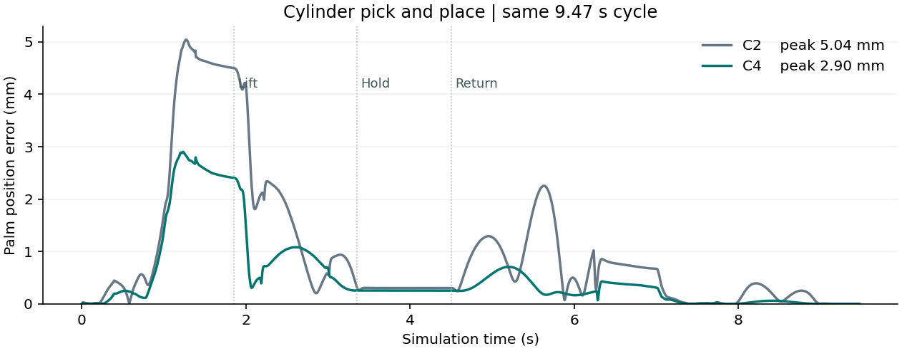

# Seven-axis cylinder pick and place | C2 vs C4

[中文首页及结果](../../README.zh-CN.md) · [Cylinder replay](media/cylinder.mp4) · [Sphere replay](media/sphere.mp4) · [Baseline mechanism and model](../seven-axis-pick-place-c2/README.md)

## Run from a fresh checkout

Install 64-bit Python 3.11 and a C++17 g++ compiler (MinGW-w64 on Windows or g++ on Linux). Make the compiler available on PATH or set CXX to its executable. Clone or download and extract the repository. In the repository root run one command:

| System | Command |
|---|---|
| Windows | `py -3.11 run_cylinder.py` |
| Linux | `python3.11 run_cylinder.py` |

The first run downloads Python packages into an isolated environment. The launcher compiles the C++ stepping library against the installed MuJoCo wheel, recomputes both full cycles headlessly, tests the outcomes and generates the figure. It runs the controller and physics in one process. ROS 2 is optional for this comparison. The homepage videos come from the archived ROS 2 Jazzy runs.

| Output under `outputs/cylinder-control/` | What to inspect |
|---|---|
| `tracking.png`, `tracking.csv` | Palm tracking error for both controllers at matching simulated times |
| `summary.json` | Tracking, placement, hold excursion, peak joint torques and tendon forces |
| `C2.json`, `C4.json` | Inputs, per-stage contact checks, outcome |
| `C2.npz`, `C4.npz` | Raw simulated state/contact histories |

## Experiment

A free upright cylinder (Ø40 × 170 mm, 33 g) starts on a table. The hand closes around it sideways, lifts to 100° elbow flexion, holds, places at a second marker and releases. The model has seven rotary arm axes, five finger-flexion tendons and a thumb-opposition actuator. The simulated control interval is 2 ms. The [acceptance code](../seven-axis-pick-place-c2/trial.py) checks that the table initially supports the object, the fingers retain it while airborne, the elbow reaches the requested hold, the object returns to the table and the fingers unload. Both nominal cycles passed.

C2 and C4 share the same [baseline recipe](../seven-axis-pick-place-c2/recipe_cylinder.json). C4 applies [three changes](cylinder_changes.json): inertial feedforward in the [joint controller](../seven-axis-pick-place-c2/dynamics.cpp), axis-specific stiffness and associated damping, and a +3.28 mm / −1.96 mm X/Z correction to the planned placement. The scoring marker stays fixed. The measured placement change is attributable to the combined controller and command revisions.

| Metric | C2 | C4 |
|---|---:|---:|
| Duration | 9.47 s | 9.47 s |
| Peak palm position error | 5.04 mm | 2.90 mm |
| RMS palm position error | 1.65 mm | 0.89 mm |
| Final cylinder placement error | 3.47 mm | 0.36 mm |
| Cylinder excursion during hold | 0.49 mm | 0.62 mm |

Palm error is the Euclidean distance between commanded and actual palm positions obtained by forward kinematics. The comparison uses the controller's own target at each timestamp. Placement error scores the object against the task marker. Hold excursion is the largest peak-to-peak motion along any one coordinate during the hold, with a 2 mm acceptance threshold. Regression checks compare against [archived nominal values](evidence/cylinder_reference.json) with absolute numerical tolerances of 0.15 mm peak, 0.08 mm RMS and 0.60 mm placement, in addition to the physical checks and the required direction of improvement.

## Where the grasp fails

At a contact friction coefficient of 0.55, the tuned cylinder trial failed the hold check with 23.89 mm of excursion. The nominal controller also reached the 25 N tendon cap on some fingers. The nominal tracking improvements describe one simulated operating condition. [Perturbation results](evidence/perturbations.json)

## ROS 2 action evidence

The [FollowJointTrajectory adapter](trajectory_action.py) is the source used in the recorded ROS trials. The nominal cylinder record covers 9.47 s with 4,736 command and feedback messages each. Separate records exercise cancellation under load and trajectory tolerance faults. These recorded checks complement the one-command physics experiment.

[Nominal cylinder](evidence/cylinder_nominal_ros_verify.json) · [Nominal sphere](evidence/ball_nominal_ros_verify.json) · [Cancellation under load](evidence/ball_cancel_loaded_ros_verify.json) · [Path-tolerance fault](evidence/cylinder_path_fault_ros_verify.json) · [Goal-tolerance fault](evidence/ball_goal_fault_ros_verify.json)

The geometry, media and source code retain the repository's [rights and permissions](../../docs/sources-and-rights.md). All performance figures on this page are simulation results.
