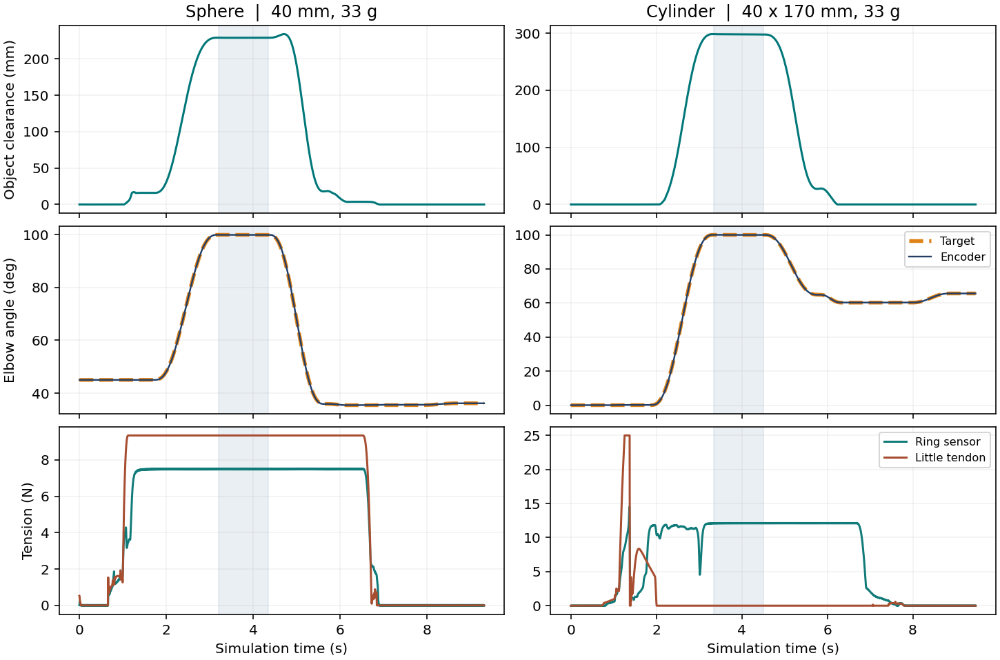
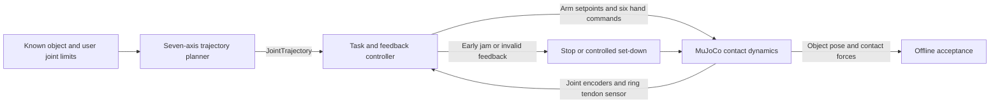

# Seven-axis tabletop pick and place with ROS 2

A 33 g free sphere and an upright 33 g cylinder are picked up from a desk, lifted to 100° elbow flexion, held and placed back. The arm has seven independent rotary axes. The hand has five flexion tendons and one thumb-opposition drive. Only the ring finger uses simulated proximal tendon-force feedback. Object pose and contact forces are used for scoring offline. No hardware test has been performed.

[中文设计与验收](README.zh-CN.md) · [Sphere replay](小球_七轴桌面取放.mp4) · [Cylinder replay](圆柱_七轴桌面取放.mp4) · [Earlier loss of grasp](早期对照_小球掉落.mp4)

| Object | Elbow motion | Held clearance | Relative hold excursion, largest component | Final horizontal placement error |
| --- | --- | --- | --- | --- |
| 40 mm sphere | 45–100° | 228.9 mm | 0.36 mm | 7.7 mm |
| 40 × 170 mm cylinder | 0–100° | 297.9 mm | 0.49 mm | 3.5 mm |

The nominal ring peak in the sphere trial was 25.00 N for prescribed stroke, 11.67 N with the threshold guard and 7.51 N with tension regulation. The same tendon commands, poses and object were used across these three laws. The glove touched the table at up to 2.76 N while setting down the sphere. The upright cylinder was placed at a second marker roughly 329 mm from the pick location.

## Reproduce

From this directory, use a 64-bit Python 3.11 environment and a C++17 g++ compiler. Set CXX to the compiler path if necessary. Install the pinned scientific packages once with `python -m pip install -r requirements.txt`. Then run:

~~~sh
python reproduce.py
~~~

This builds the small native step library and recomputes both tasks. For the actual ROS 2 transport on Windows, install Pixi, set ARM_SOLVER_PYTHON to the absolute path of that same scientific environment's python.exe and run `.\一键复跑.ps1 -Mode ros`. The win-64 ROS 2 environment is pinned separately. Each run records messages in rosbag2 SQLite, decodes them and checks sequence continuity. These are three custom Jazzy nodes using JointTrajectory and simulated-time lockstep, one feedback and one command per 2 ms. Local runs validated Windows. Native editable CAD stays in the private engineering archive.

## Evaluation

[38 nominal, offset, friction, step-size and fault cases](acceptance.jsonl) · [42 matched controller comparisons](law_comparison.jsonl) · [Two single-retry cases after a cleared jam](cleared_jam_retry.json) · [Joint-by-joint tests](七轴单动与限位.json) · [Tracking, torque and orientation metrics](tracking_metrics.json). Use `python commission.py`, `python compare_laws.py` and `python retry_recovery.py` to recompute the batches. The starting R8.11 geometry uses reduced collision meshes. Drive caps, inertia estimates, contact friction, glove compliance and ring sensor transmission remain simulation assumptions. Command sequencing and the model are project-specific.

The included Python and C++ source in this study is under the repository MIT license. Mechanical geometry, model parameters, results and media follow the [hardware and data permissions](../../docs/sources-and-rights.md).

## Control and feedback

