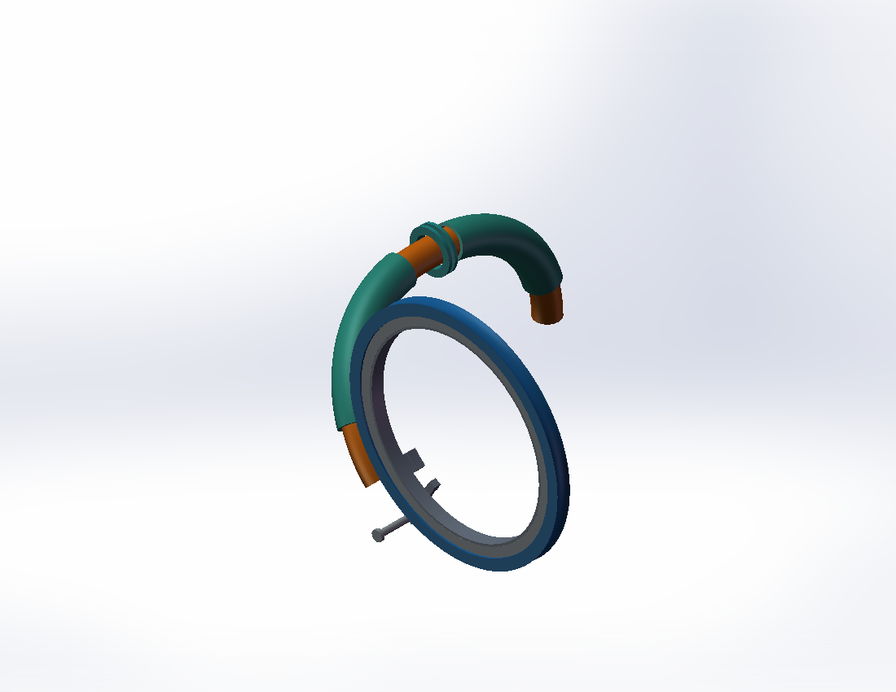
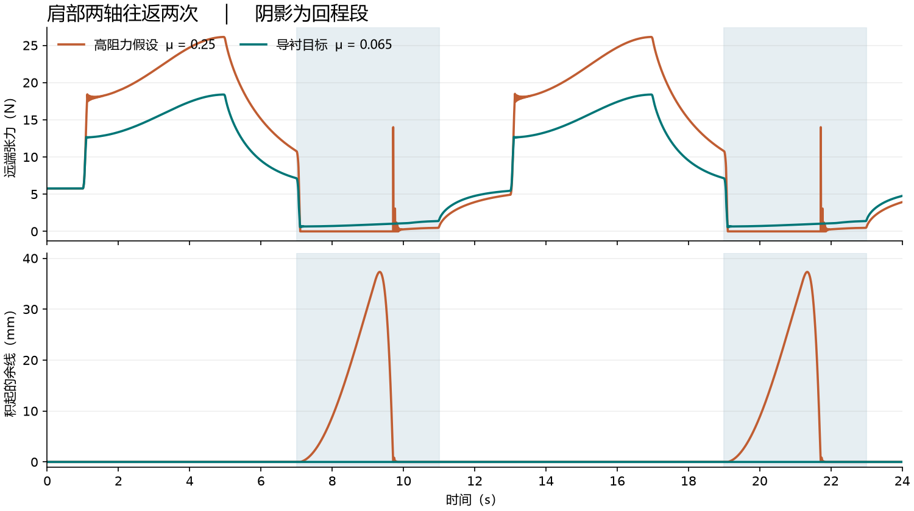

# R8.4 · Will the shoulder take up the cable on the way back?

The inner shoulder axis travels from −90° to +90°, and the outer axis from 0° to 90°. Turning them together can pay out about 377 mm of cable. The design question is whether the torso take-up can recover that length during reversal. The arm can look taut at the end even if it went slack halfway through.



**Simulation milestone · physical drag pending.** R8.1 uses a fixed shoulder guide. R8.4 keeps the take-up, adds a passive idler on the first shoulder axis and places split liners on two bends of the fixed feed (R80 and R86 mm). The black and blue ring above is the idler assembly, green marks the liners, and orange shows the modeled harness. [Whole-arm CAD view](images/assembly.png)

## What changed the result

Five synchronized shoulder paths were run twice from rest with state carried through reversal. With the target liner friction coefficient of 0.065 and 0.35 N additional fixed-feed resistance, the 4 s one-way motion kept all cable segments under tension. Increasing assumed low-speed resistance near reversal left **0.38 N** minimum across the five paths. Real harness friction and clamp preload remain unmeasured.

| Configuration on the maximum payout path | Peak free cable during return |
|---|---:|
| R8.1 fixed guide, high feed drag | 45.63 mm |
| Shoulder idler only, same high drag | 45.85 mm |
| R8.4 idler + lined bends, target drag | 0 mm |
| R8.4 idler + lined bends, high liner friction | 37.32 mm |

The first two cases use μ=0.25 and 0.65 N additional feed drag. The last two keep the feed offset at 0.35 N and vary **only** lined-arc μ from 0.065 to 0.25. For the fourth case slack peaks during the return, then falls to zero by the end. [Matched guide comparison](evidence/boundary.csv) · [Refined friction comparison](evidence/convergence.csv)



## Can slower motion compensate for friction?

The new speed study repeats the maximum excursion from each end, at 2, 3, 4, 6 and 8 s each way, with two full cycles per case. Changing the travel time also changes acceleration through the half-cosine motion profile. Both axes reach the same angles in every case. The table gives the worse result of the two starting directions over the entire cycle.

| One-way time | Minimum tension at target drag | Maximum slack at high friction |
|---|---:|---:|
| 2 s | 0.319 N | 39.74 mm |
| 4 s | 0.556 N | 37.35 mm |
| 8 s | 0.646 N | 35.35 mm |

At the target drag, all ten speed/direction combinations maintained tension. At high friction, all ten lost tension. Choosing a slower motion improved the margin but left substantial slack in the high-friction cases. [All 20 speed cases](evidence/speed.csv)

## Geometry and assumptions

- Three SolidWorks assemblies were reopened and rebuilt with 519 local component instances each. At the three sampled poses, checking pairs involving the new components detected zero positive-volume intersections. All four liners had 0.600 mm nominal clearance to the Ø16 mm bundle in the down pose. [Poses](evidence/native.csv) · [Interference counts](evidence/native-summary.csv) · [Measured CAD gaps](evidence/native-gap.csv)
- The model represents an upright torso, a moving take-up, four tension-only cable spans, three friction locations and the passive idler's rotational inertia. It predicts surplus cable length. The shape of the loose cable, clamp deformation and wear are outside the model. The CAD poses and transient cable calculation are separate checks.
- Lined arcs cover 128.7° of the 180° fixed feed. Remaining contact is assumed to slide at μ=0.25. The target values correspond to **2.67 N additional steady pull at 5 N inlet tension** across the complete feed. This is a design target. Cable jacket, guide surface, preload and their condition determine achieved resistance. [Cable friction measurement practice](https://www.polywater.com/Tech/FTable.pdf)

## Reproduce

From this folder, using Python 3.11, run the two key comparisons with:

```sh
python -m pip install -r requirements.txt
python verify.py
```

Run the complete study with the commands below. They write new results under the repository's `outputs/shoulder-return-r84/`. The archived results in `evidence/` remain available for comparison.

```sh
python solver.py
python solver.py --boundary
python solver.py --refine .065 .18 .21 .25
python speed_study.py
```

[Five-path and breakaway cases](evidence/transients.csv) · [Model source](solver.py) · [Hardware and media permissions](../../docs/sources-and-rights.md)

## 中文摘要

本轮保留 R8.1 作对照。只换滚轮，高阻力时回程仍会松出约 46 mm 线。把两道固定弯的阻力降到设计目标，五条联动路径各走两个往返，模型中均保持张紧。新增的速度对照说明，肩膀慢一些可以增加余量，但即使每程放慢到 8 秒，高摩擦时仍会松出约 35 mm。三个离散姿态已做 SolidWorks 实体复查。以上均为 CAD 与仿真阶段成果，实际阻力待测。
